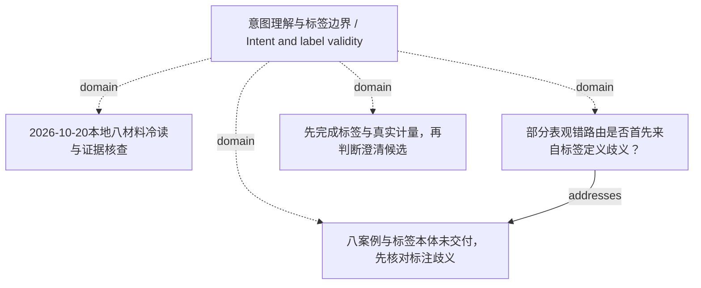

<!-- Generated by Agent Research Atlas; edit atlas.json via upsert or notes.md. -->
# 意图理解与标签边界 / Intent and label validity

[Atlas overview](../../MAP.md) · [Human notes](notes.md)

Coverage: **partial**

## Recorded relationships



## Evidence and exploration

### 八案例与标签本体未交付，先核对标注歧义

`problem-labels` · problem · unresolved

```json
{
  "legacy_note": "先检查标注歧义，再归因于模型。",
  "observation": "资源说明称有8条合成案例；原始8个文件不含案例/真值表。",
  "unknowns": [
    "每条案例内容、case/family ID",
    "标签定义和来源",
    "多路由是否合法",
    "逐案例预测"
  ]
}
```

- docs/prior-map.md — access: local; locator: 保留笔记
- docs/resources.md — access: local; locator: 全文
- reviews/2026-10-20/source-manifest.json — access: local; locator: /sources

### 2026-10-20本地八材料冷读与证据核查

`explore-local-review` · exploration · local_pass_completed

```json
{
  "actual_read_scope": "所有8份原始文件全文",
  "artifact_path": "reviews/2026-10-20/evidence-review.md",
  "discovery_truncated": false,
  "language": "mixed",
  "limitations": "0次外部检索；没有研究执行、有效新测量或独立评测。只知道本地材料内容。",
  "provider": "local file reading / static AST / standard-library audit tools",
  "query": "既有地图、论文记录、回执、代码和结果草稿能支持哪些结论？",
  "read_files": 8,
  "result_ids": [
    "paper-synthetic-abstract-a"
  ],
  "review": {
    "limitations": "同一审查者做本轮整理；未复现实验，所有项目材料为教学用合成fixture。",
    "reviewed_at": "2026-10-20",
    "reviewer": "cold_evidence_review",
    "summary": "全文冷读原始八文件；旧草稿撤回越界表述，主问题保留。"
  },
  "scope": "SYNTHETIC教学材料的离线证据审计：歧义请求的一次澄清、二路由、标签与评测；仅本地8个原始文件，截至2026-10-20。未联网、安装、运行研究负载、调用付费资源或发布。真实文献查新与独立实验均未完成。",
  "searched_at": "2026-10-20"
}
```

- reviews/2026-10-20/source-manifest.json — access: local; locator: /sources
- reviews/2026-10-20/evidence-review.md — access: local; locator: 全文

### 部分表观错路由是否首先来自标签定义歧义？

`hyp-label-ambiguity` · hypothesis · proposed

```json
{
  "closest_paper_ids": [],
  "depends_on": [
    "problem-labels",
    "problem-measurement"
  ],
  "falsification": "有效复核显示所有标签唯一一致，会削弱该批数据上的标签歧义解释；仍须修复计量。",
  "feasibility": {
    "budget": "unavailable",
    "compute": "available",
    "data": "unverified",
    "evaluation": "unavailable"
  },
  "feasibility_notes": "资源说明为本地CPU，适用于未来规则型小诊断的条件估计；但八条案例/标签未交付、真实评价器缺失、本轮明确不授权研究负载。无GPU/API支出授权。真实近邻未知，不能升级testable。",
  "mechanism": "存在多种合法路由时，固定单标签可能把合规输出计成错误。",
  "minimal_test": "恢复原八条案例，先定义search/chat语义和允许标签集，保留争议与版本，再看输出。",
  "prediction": "盲于方法预测的标签复核会标出需多标签/条件规则或澄清的案例；目前没有已观察数量。",
  "priority": "P0 diagnostic prerequisite",
  "problem": "参考标签与案例未交付，无法检查路线判断是否唯一。",
  "rival_explanations": [
    "标签明确正确，问题在词面原型或评价器",
    "复核者受结果影响迁就方法"
  ],
  "status_reason": "保留旧笔记的诊断优先级；没有案例，不能声称已发现标注错误。"
}
```

- docs/prior-map.md — access: local; locator: 保留笔记
- plans/minimal-discriminating-study.md — access: local; locator: P0

### 先完成标签与真实计量，再判断澄清候选

`decision-prioritize-measurement` · decision · continue_after_prerequisites

```json
{
  "depends_on": [
    "problem-measurement",
    "problem-labels",
    "hyp-targeted-clarification"
  ],
  "next": "完成方案P0，再执行后续获授权的P1。",
  "reason": "更多seed不能解决硬编码指标和缺失真值；计量有效性最先改变判断。",
  "status_reason": "保留研究问题，先解决可见证据缺口。"
}
```

- reviews/2026-10-20/evidence-review.md — access: local; locator: 四、候选取舍
- plans/minimal-discriminating-study.md — access: local; locator: 全文

