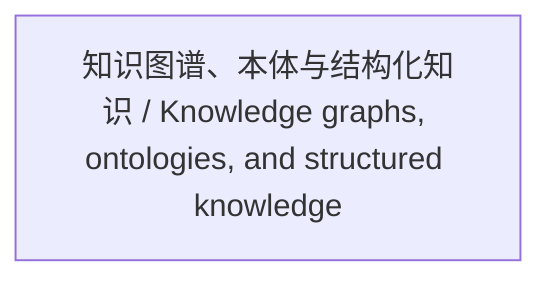

<!-- Generated by Agent Research Atlas; edit atlas.json via upsert or notes.md. -->
# 知识图谱、本体与结构化知识 / Knowledge graphs, ontologies, and structured knowledge

[Atlas overview](../../MAP.md) · [Human notes](notes.md)

Coverage: **unsearched**

## Recorded relationships

## Evidence and exploration

