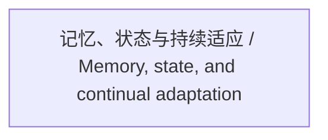

<!-- Generated by Agent Research Atlas; edit atlas.json via upsert or notes.md. -->
# 记忆、状态与持续适应 / Memory, state, and continual adaptation

[Atlas overview](../../MAP.md) · [Human notes](notes.md)

Coverage: **unsearched**

## Recorded relationships

## Evidence and exploration

