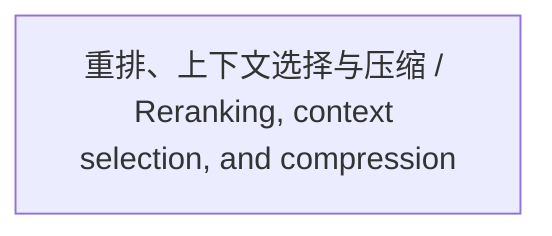

<!-- Generated by Agent Research Atlas; edit atlas.json via upsert or notes.md. -->
# 重排、上下文选择与压缩 / Reranking, context selection, and compression

[Atlas overview](../../MAP.md) · [Human notes](notes.md)

Coverage: **unsearched**

## Recorded relationships

## Evidence and exploration

