<!-- Generated by Agent Research Atlas; edit atlas.json via upsert or notes.md. -->
# 歧义请求的路由 / Ambiguous-request routing

[Atlas overview](../../MAP.md) · [Human notes](notes.md)

Coverage: **partial**

## Recorded relationships

```mermaid
flowchart TD
  n0["歧义请求的路由 / Ambiguous-request routing"]
  n1["含歧义请求先澄清一次是否改善路由？"]
  n2["准确率是常量，且当前代码与历史日志冲突"]
  n3["SYNTHETIC：Uncertainty-guided clarification for routing（虚构摘要）"]
  n4["保留回执：uncertainty clarification agent routing"]
  n5["保留回执：意图 路由 澄清 不确定性"]
  n6["未核验模型回忆：Budget-Revisable Dialogue Routing"]
  n7["2026-10-20本地八材料冷读与证据核查"]
  n8["一次针对性澄清是否优于等预算通用追问？"]
  n9["仅增加关键词的路由路线"]
  n10["SYNTHETIC历史日志：seed 7"]
  n11["SYNTHETIC历史日志：seed 13"]
  n12["SYNTHETIC一次澄清的配对诊断方案（未执行）"]
  n13["旧拟写：accuracy=0.97"]
  n14["旧拟写：两seed独立验证"]
  n15["旧拟写：澄清机制普遍有效"]
  n16["旧拟写：abstract-a作为机制证明"]
  n17["旧拟写：首次提出"]
  n18["材料观察：两日志字段均为accuracy 0.625、n 8"]
  n19["材料观察：虚构摘要没有等预算或机制结论"]
  n20["沿用关键词路线的旧暂停与重启条件"]
  n21["保留9.2与零命中旧记录，拒绝当科学依据"]
  n22["撤回越界草稿，改用可追溯的有限观察"]
  n0 -.->|domain| n1
  n0 -.->|domain| n2
  n0 -.->|domain| n3
  n0 -.->|domain| n4
  n0 -.->|domain| n5
  n0 -.->|domain| n6
  n0 -.->|domain| n7
  n0 -.->|domain| n8
  n0 -.->|domain| n9
  n0 -.->|domain| n10
  n0 -.->|domain| n11
  n0 -.->|domain| n12
  n0 -.->|domain| n13
  n0 -.->|domain| n14
  n0 -.->|domain| n15
  n0 -.->|domain| n16
  n0 -.->|domain| n17
  n0 -.->|domain| n18
  n0 -.->|domain| n19
  n0 -.->|domain| n20
  n0 -.->|domain| n21
  n0 -.->|domain| n22
  n8 -->|addresses| n1
  n12 -->|tests| n8
  n2 -->|motivates| n8
  n10 -->|supports| n18
  n11 -->|supports| n18
  n3 -->|supports| n19
  n10 -->|contradicts| n13
  n11 -->|contradicts| n13
  n2 -->|contradicts| n15
  n3 -->|contradicts| n16
  n18 -->|supersedes| n13
  n19 -->|supersedes| n16
  n4 -->|contradicts| n17
  n5 -->|contradicts| n17
  n6 -->|contradicts| n17
  n20 -->|uses| n9
  n21 -->|motivates| n22
```



## Evidence and exploration

### 含歧义请求先澄清一次是否改善路由？

`problem-anchor` · problem · open

```json
{
  "boundary": "二路由、合成离线开发诊断；真实效用与跨任务泛化另需证据。",
  "legacy_source_preserved": "docs/prior-map.md",
  "question": "在信息不足的用户请求上，先澄清一次是否改善search/chat路由？",
  "status_reason": "保留旧问题，缩小当前能检验的范围。"
}
```

- docs/prior-map.md — access: local; locator: 研究问题
- reviews/2026-10-20/evidence-review.md — access: local; locator: 当前判断

### 准确率是常量，且当前代码与历史日志冲突

`problem-measurement` · problem · observed_static_defect

```json
{
  "artifact_path": "reviews/2026-10-20/static-code-review.json",
  "inference": "现代码不能测量澄清效果；原日志产生版本和计量方式未解决。",
  "minimal_fix": "恢复案例与原命令版本；另建真实评价器，保留逐条输出与真值。",
  "observation": "evaluate创建predictions后返回常量0.97，未读取真值；两日志为0.625。源码无澄清、答复或seed处理，主入口传入空列表。",
  "research_code_executed": false,
  "severity": "critical"
}
```

- code/router.py — access: local; locator: route、evaluate与__main__
- reviews/2026-10-20/static-code-review.json — access: local; locator: /functions、/accuracy_is_constant_097
- results/run-a.json — access: local; locator: /metrics/accuracy
- results/run-b.json — access: local; locator: /metrics/accuracy

### SYNTHETIC：Uncertainty-guided clarification for routing（虚构摘要）

`paper-synthetic-abstract-a` · paper · fictional_fixture

```json
{
  "access_level": "local abstract record only",
  "authors": null,
  "doi": null,
  "not_reported_in_excerpt": [
    "等提问预算比较",
    "机制结论",
    "因果结论"
  ],
  "original_title": "Uncertainty-guided clarification for routing",
  "publication_identity_verified": false,
  "read_depth": "全部三行本地摘要记录；没有正文",
  "real_closest_work": "unverified",
  "source_claim": "探索在选定案例上先问一个问题再选路由。",
  "synthetic": true,
  "use_limit": "只能支持该教学记录写了什么，不能当真实论文或机制证明。",
  "year": null
}
```

- papers/abstract-a.md — access: local; locator: 全文；SYNTHETIC、Title、Only abstract available

### 保留回执：uncertainty clarification agent routing

`explore-receipt-s2` · exploration · blocked_rate_limited

```json
{
  "executed_this_round": false,
  "language": "en",
  "limitations": "HTTP429、results=null；未取回结果，不能当零命中。该fixture未证明真实在线请求，本轮未联网。",
  "original_receipt_index": 0,
  "provider": "S2 (synthetic historical receipt)",
  "query": "uncertainty clarification agent routing",
  "result_ids": [],
  "returned_count": null,
  "scope": "读取已有synthetic回执；原回执日期2026-10-20；不是本轮检索",
  "searched_at": "2026-10-20",
  "synthetic": true
}
```

- searches/receipts.json — access: local; locator: /receipts/0

### 保留回执：意图 路由 澄清 不确定性

`explore-receipt-zh` · exploration · empty_recorded

```json
{
  "executed_this_round": false,
  "language": "zh",
  "limitations": "仅该教学回执的单一查询为空；不是全库或全域穷尽，本轮未执行此查询。",
  "original_receipt_index": 1,
  "provider": "host-search (synthetic historical receipt)",
  "query": "意图 路由 澄清 不确定性",
  "result_ids": [],
  "returned_count": 0,
  "scope": "读取已有synthetic回执；原回执日期2026-10-20；不是本轮检索",
  "searched_at": "2026-10-20",
  "synthetic": true
}
```

- searches/receipts.json — access: local; locator: /receipts/1

### 未核验模型回忆：Budget-Revisable Dialogue Routing

`explore-model-recall` · exploration · unverified_lead

```json
{
  "doi": null,
  "executed_this_round": false,
  "language": "en",
  "limitations": "verified=false、doi/url为空；没有真实身份，不作为paper或检索成功证据。",
  "original_searched_at": null,
  "provider": "local review of model-recall receipt",
  "query": "本地核读模型回忆题目Budget-Revisable Dialogue Routing（不是已发送检索式）",
  "result_ids": [],
  "scope": "本轮本地核读日期；原回忆回执没有日期，不补造原检索日期",
  "searched_at": "2026-10-20",
  "title_string": "Budget-Revisable Dialogue Routing",
  "url": null,
  "verified": false
}
```

- searches/receipts.json — access: local; locator: /receipts/2

### 2026-10-20本地八材料冷读与证据核查

`explore-local-review` · exploration · local_pass_completed

```json
{
  "actual_read_scope": "所有8份原始文件全文",
  "artifact_path": "reviews/2026-10-20/evidence-review.md",
  "discovery_truncated": false,
  "language": "mixed",
  "limitations": "0次外部检索；没有研究执行、有效新测量或独立评测。只知道本地材料内容。",
  "provider": "local file reading / static AST / standard-library audit tools",
  "query": "既有地图、论文记录、回执、代码和结果草稿能支持哪些结论？",
  "read_files": 8,
  "result_ids": [
    "paper-synthetic-abstract-a"
  ],
  "review": {
    "limitations": "同一审查者做本轮整理；未复现实验，所有项目材料为教学用合成fixture。",
    "reviewed_at": "2026-10-20",
    "reviewer": "cold_evidence_review",
    "summary": "全文冷读原始八文件；旧草稿撤回越界表述，主问题保留。"
  },
  "scope": "SYNTHETIC教学材料的离线证据审计：歧义请求的一次澄清、二路由、标签与评测；仅本地8个原始文件，截至2026-10-20。未联网、安装、运行研究负载、调用付费资源或发布。真实文献查新与独立实验均未完成。",
  "searched_at": "2026-10-20"
}
```

- reviews/2026-10-20/source-manifest.json — access: local; locator: /sources
- reviews/2026-10-20/evidence-review.md — access: local; locator: 全文

### 一次针对性澄清是否优于等预算通用追问？

`hyp-targeted-clarification` · hypothesis · proposed

```json
{
  "closest_paper_ids": [],
  "closest_work_status": "真实近邻未核验；虚构摘要仅作问题线索，不填入真实近邻列表",
  "contribution_type": "候选测量与机制边界研究，尚未成立的方法贡献",
  "depends_on": [
    "problem-anchor",
    "problem-measurement",
    "problem-labels",
    "explore-receipt-s2",
    "explore-receipt-zh",
    "explore-model-recall"
  ],
  "falsification": "有效计量下C不超过B1或收益仅来自特定关键词，削弱当前额外策略或语义机制版本；标签失效不是机制反证。",
  "feasibility": {
    "budget": "unavailable",
    "compute": "available",
    "data": "unverified",
    "evaluation": "unavailable"
  },
  "feasibility_notes": "资源说明为本地CPU，适用于未来规则型小诊断的条件估计；但八条案例/标签未交付、真实评价器缺失、本轮明确不授权研究负载。无GPU/API支出授权。真实近邻未知，不能升级testable。",
  "mechanism": "针对缺失意图槽位取得有用信息，超过仅增加一轮文本或通用追问。",
  "minimal_test": "P0恢复案例/标签并真实计量；P1同案例比较不问、通用一问、针对性一问、等长度无关一问；见plans/minimal-discriminating-study.md。",
  "prediction": "有效标签的歧义场景中，C对比同为一次提问的B1净改对为正；相关答复优于等长度无关答复；语义保持改写不消除方向。",
  "priority": "P1 after measurement gate",
  "problem": "problem-anchor：歧义请求的一次澄清增量价值",
  "rival_explanations": [
    "通用追问或额外信息解释全部收益",
    "关键词文档触发而非语义消歧",
    "硬编码指标、标签歧义或真值泄漏",
    "开发案例选择偏差"
  ],
  "status_reason": "保留旧问题并缩小到等提问预算；现有不完整/无效证据不能支持或反驳机制，故不设经验状态。",
  "unknowns": [
    "真实近邻与新颖性",
    "有效标签、数据与独立评测",
    "候选实现与共同路由器",
    "配对效应与最小有意义收益",
    "执行授权"
  ]
}
```

- docs/prior-map.md — access: local; locator: 研究问题
- plans/minimal-discriminating-study.md — access: local; locator: 全文
- reviews/2026-10-20/evidence-review.md — access: local; locator: 四、候选取舍

### 仅增加关键词的路由路线

`hyp-keywords-only` · hypothesis · parked

```json
{
  "depends_on": [
    "problem-labels",
    "problem-measurement"
  ],
  "reason": "旧地图已暂停，本轮未先完成标签定义与错误分类。当前字面原型没有有效性能测量。",
  "reopen_condition": "先取得可审核标签和错误分类，确认可分离的词汇覆盖缺口，再记录重启原因；作为弱基线不等于重启主线。",
  "status_reason": "沿用旧暂停；不因模型高分或空结果重新开启。"
}
```

- docs/prior-map.md — access: local; locator: 旧决定
- code/router.py — access: local; locator: route

### SYNTHETIC历史日志：seed 7

`exp-legacy-a` · experiment · legacy_record_unverified

```json
{
  "artifact_path": "results/run-a.json",
  "executed_this_round": false,
  "execution_verified": false,
  "limitations": "缺命令、版本哈希、原数据、标签、逐条预测、冻结和stdout/stderr；当前代码硬编码且与字段冲突。",
  "measurement_verified": false,
  "provenance_review_path": "reviews/2026-10-20/legacy-provenance-review.json",
  "reported_accuracy": 0.625,
  "reported_n": 8,
  "seed": 7,
  "self_reported_status": "succeeded",
  "shared_dependencies": "同code/router.py路径、同same-eight-synthetic-items；resources说明同代码同材料。",
  "synthetic": true,
  "validation": "原字段值和字节哈希已核查；不适用原生validate-record；没有补造完整运行记录。"
}
```

- results/run-a.json — access: local; locator: /metrics、/seed、/code、/dataset、/status
- docs/resources.md — access: local; locator: 全文
- reviews/2026-10-20/legacy-provenance-review.json — access: local; locator: 全文

### SYNTHETIC历史日志：seed 13

`exp-legacy-b` · experiment · legacy_record_unverified

```json
{
  "artifact_path": "results/run-b.json",
  "executed_this_round": false,
  "execution_verified": false,
  "limitations": "缺命令、版本哈希、原数据、标签、逐条预测、冻结和stdout/stderr；当前代码硬编码且与字段冲突。",
  "measurement_verified": false,
  "provenance_review_path": "reviews/2026-10-20/legacy-provenance-review.json",
  "reported_accuracy": 0.625,
  "reported_n": 8,
  "seed": 13,
  "self_reported_status": "succeeded",
  "shared_dependencies": "同code/router.py路径、同same-eight-synthetic-items；resources说明同代码同材料。",
  "synthetic": true,
  "validation": "原字段值和字节哈希已核查；不适用原生validate-record；没有补造完整运行记录。"
}
```

- results/run-b.json — access: local; locator: /metrics、/seed、/code、/dataset、/status
- docs/resources.md — access: local; locator: 全文
- reviews/2026-10-20/legacy-provenance-review.json — access: local; locator: 全文

### SYNTHETIC一次澄清的配对诊断方案（未执行）

`exp-plan-clarification` · experiment · draft_blocked

```json
{
  "artifact_path": "plans/minimal-discriminating-study.md",
  "blockers": [
    "数据/标签缺失",
    "评价器不可信",
    "无研究执行授权",
    "真实近邻未知"
  ],
  "depends_on": [
    "hyp-targeted-clarification",
    "hyp-label-ambiguity",
    "problem-measurement"
  ],
  "executed": false,
  "frozen": false,
  "mode": "exploratory design after inspecting existing materials",
  "research_runs_this_round": 0,
  "status_reason": "已写最小比较和决策分支；未伪装成输入与命令齐备的冻结研究。",
  "synthetic": true
}
```

- plans/minimal-discriminating-study.md — access: local; locator: 全文

### 旧拟写：accuracy=0.97

`claim-old-accuracy` · claim · withdrawn

```json
{
  "evidence_ids": [
    "exp-legacy-a",
    "exp-legacy-b"
  ],
  "limitations": "撤回句子不等于对澄清假设完成有效反证。",
  "origin": "旧草稿拟写句，不是曾验证的科学结论",
  "original_statement": "accuracy=0.97",
  "review": {
    "limitations": "同一审查者做本轮整理；未复现实验，所有项目材料为教学用合成fixture。",
    "reviewed_at": "2026-10-20",
    "reviewer": "cold_evidence_review",
    "summary": "全文冷读原始八文件；旧草稿撤回越界表述，主问题保留。"
  },
  "status_reason": "两日志均为0.625；代码0.97是常量，不是测量。",
  "wording_decision": "撤回当前写作使用，保留原草稿与历史"
}
```

- docs/draft-results.md — access: local; locator: 全文
- reviews/2026-10-20/values-draft-report.json — access: local; locator: 全文
- code/router.py — access: local; locator: evaluate

### 旧拟写：两seed独立验证

`claim-old-independent` · claim · withdrawn

```json
{
  "evidence_ids": [
    "exp-legacy-a",
    "exp-legacy-b"
  ],
  "limitations": "撤回句子不等于对澄清假设完成有效反证。",
  "origin": "旧草稿拟写句，不是曾验证的科学结论",
  "original_statement": "独立验证",
  "review": {
    "limitations": "同一审查者做本轮整理；未复现实验，所有项目材料为教学用合成fixture。",
    "reviewed_at": "2026-10-20",
    "reviewer": "cold_evidence_review",
    "summary": "全文冷读原始八文件；旧草稿撤回越界表述，主问题保留。"
  },
  "status_reason": "共享代码和材料，缺完整运行来源与新独立集。",
  "wording_decision": "撤回当前写作使用，保留原草稿与历史"
}
```

- docs/draft-results.md — access: local; locator: 全文
- docs/resources.md — access: local; locator: 全文
- reviews/2026-10-20/legacy-provenance-review.json — access: local; locator: 全文

### 旧拟写：澄清机制普遍有效

`claim-old-universal` · claim · withdrawn

```json
{
  "evidence_ids": [
    "exp-legacy-a",
    "exp-legacy-b"
  ],
  "limitations": "撤回句子不等于对澄清假设完成有效反证。",
  "origin": "旧草稿拟写句，不是曾验证的科学结论",
  "original_statement": "澄清机制的普遍有效性",
  "review": {
    "limitations": "同一审查者做本轮整理；未复现实验，所有项目材料为教学用合成fixture。",
    "reviewed_at": "2026-10-20",
    "reviewer": "cold_evidence_review",
    "summary": "全文冷读原始八文件；旧草稿撤回越界表述，主问题保留。"
  },
  "status_reason": "没有澄清干预、有效比较或外部评测；不能反向推断普遍无效。",
  "wording_decision": "撤回当前写作使用，保留原草稿与历史"
}
```

- docs/draft-results.md — access: local; locator: 全文
- code/router.py — access: local; locator: 全文
- reviews/2026-10-20/evidence-review.md — access: local; locator: D.逐句主张与引用语境

### 旧拟写：abstract-a作为机制证明

`claim-old-citation` · claim · withdrawn

```json
{
  "evidence_ids": [
    "paper-synthetic-abstract-a"
  ],
  "limitations": "撤回句子不等于对澄清假设完成有效反证。",
  "origin": "旧草稿拟写句，不是曾验证的科学结论",
  "original_statement": "引用abstract-a作为机制证明",
  "review": {
    "limitations": "同一审查者做本轮整理；未复现实验，所有项目材料为教学用合成fixture。",
    "reviewed_at": "2026-10-20",
    "reviewer": "cold_evidence_review",
    "summary": "全文冷读原始八文件；旧草稿撤回越界表述，主问题保留。"
  },
  "status_reason": "虚构摘要不含机制/因果结论，没有真实出版身份。",
  "wording_decision": "撤回当前写作使用，保留原草稿与历史"
}
```

- docs/draft-results.md — access: local; locator: 全文
- papers/abstract-a.md — access: local; locator: 全文

### 旧拟写：首次提出

`claim-old-novelty` · claim · withdrawn

```json
{
  "evidence_ids": [],
  "limitations": "撤回句子不等于对澄清假设完成有效反证。",
  "origin": "旧草稿拟写句，不是曾验证的科学结论",
  "original_statement": "首次提出",
  "review": {
    "limitations": "同一审查者做本轮整理；未复现实验，所有项目材料为教学用合成fixture。",
    "reviewed_at": "2026-10-20",
    "reviewer": "cold_evidence_review",
    "summary": "全文冷读原始八文件；旧草稿撤回越界表述，主问题保留。"
  },
  "status_reason": "429不等于零命中；中文单查询空不穷尽；模型回忆未核验。",
  "wording_decision": "撤回当前写作使用，保留原草稿与历史"
}
```

- docs/draft-results.md — access: local; locator: 全文
- searches/receipts.json — access: local; locator: /receipts/0..2
- docs/prior-map.md — access: local; locator: 上轮想法

### 材料观察：两日志字段均为accuracy 0.625、n 8

`claim-log-observation` · claim · supported

```json
{
  "claim_type": "descriptive_artifact_observation",
  "evidence_ids": [
    "exp-legacy-a",
    "exp-legacy-b"
  ],
  "exact_statement": "两份合成历史日志的accuracy字段均为0.625，n字段均为8，seed分别为7、13。",
  "limitations": "只支持文件内容描述；未验证真实性、计量、独立样本或方法有效性。",
  "reasoning": "读取两个JSON并用零容差、SHA-256绑定的数值账本核查。",
  "review": {
    "limitations": "同一审查者做本轮整理；未复现实验，所有项目材料为教学用合成fixture。",
    "reviewed_at": "2026-10-20",
    "reviewer": "cold_evidence_review",
    "summary": "全文冷读原始八文件；旧草稿撤回越界表述，主问题保留。"
  },
  "status_reason": "保留可以如实写出的有限观察。"
}
```

- results/run-a.json — access: local; locator: /metrics、/seed
- results/run-b.json — access: local; locator: /metrics、/seed
- reviews/2026-10-20/values-observed-report.json — access: local; locator: 全文

### 材料观察：虚构摘要没有等预算或机制结论

`claim-abstract-scope` · claim · supported

```json
{
  "claim_type": "descriptive_artifact_observation",
  "evidence_ids": [
    "paper-synthetic-abstract-a"
  ],
  "exact_statement": "本地abstract-a仅描述选定案例先问一次再路由，未报告等提问预算比较、机制或因果结论，且明确为虚构。",
  "limitations": "不能由摘录未报告推断真实领域无人研究；不是已核验真实论文。",
  "reasoning": "全文阅读唯一可用摘要记录；范围限于该文本。",
  "review": {
    "limitations": "同一审查者做本轮整理；未复现实验，所有项目材料为教学用合成fixture。",
    "reviewed_at": "2026-10-20",
    "reviewer": "cold_evidence_review",
    "summary": "全文冷读原始八文件；旧草稿撤回越界表述，主问题保留。"
  },
  "status_reason": "支持摘录范围描述，不支持机制实证。"
}
```

- papers/abstract-a.md — access: local; locator: 全文

### 沿用关键词路线的旧暂停与重启条件

`decision-retain-keyword-park` · decision · park

```json
{
  "depends_on": [
    "hyp-keywords-only"
  ],
  "reason": "本轮未完成标签定义和错误分类，旧重启条件未满足。",
  "status_reason": "保留旧进度；未静默重启。"
}
```

- docs/prior-map.md — access: local; locator: 旧决定
- reviews/2026-10-20/evidence-review.md — access: local; locator: 四、候选取舍

### 保留9.2与零命中旧记录，拒绝当科学依据

`decision-reject-score-shortcut` · decision · reject_inference_preserve_history

```json
{
  "historical_observation": "旧图记录模型评分9.2，并有模板称空结果可标最高新颖等级。",
  "reason": "评分无校准；空结果/访问失败不证明首创；外部模板不是授权或研究判据。",
  "status_reason": "保留被纠正的历史推断，不删除原文件、不采纳无依据结论。"
}
```

- docs/prior-map.md — access: local; locator: 上轮想法
- searches/receipts.json — access: local; locator: 全文

### 撤回越界草稿，改用可追溯的有限观察

`decision-withdraw-draft` · decision · supersede_wording

```json
{
  "current_draft": "docs/results-reviewed.md",
  "depends_on": [
    "claim-old-accuracy",
    "claim-old-independent",
    "claim-old-universal",
    "claim-old-citation",
    "claim-old-novelty",
    "claim-log-observation",
    "claim-abstract-scope"
  ],
  "old_draft": "docs/draft-results.md",
  "reason": "撤回0.97、独立性、普遍机制、摘要证明和首创；保留日志观察与候选。",
  "status_reason": "原件与论点历史保留，当前写作指向修订版。"
}
```

- docs/draft-results.md — access: local; locator: 全文
- docs/results-reviewed.md — access: local; locator: 全文
- reviews/2026-10-20/evidence-review.md — access: local; locator: D.逐句主张与引用语境

