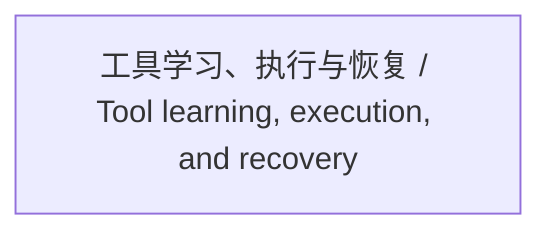

<!-- Generated by Agent Research Atlas; edit atlas.json via upsert or notes.md. -->
# 工具学习、执行与恢复 / Tool learning, execution, and recovery

[Atlas overview](../../MAP.md) · [Human notes](notes.md)

Coverage: **unsearched**

## Recorded relationships

## Evidence and exploration

