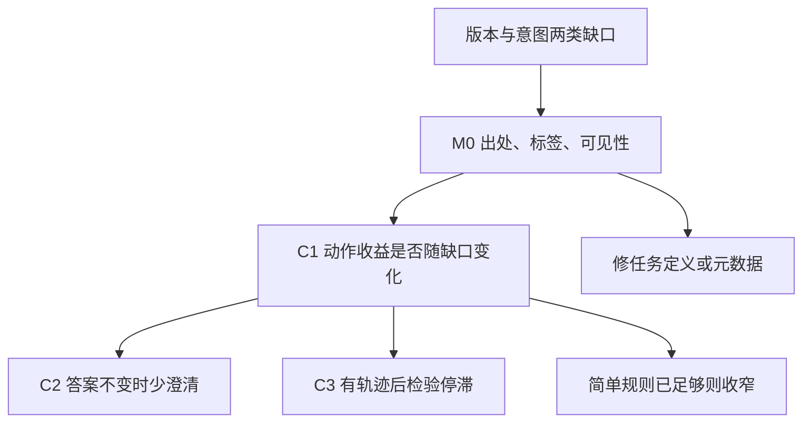

# 简明研究地图

2026-10-20。**SYNTHETIC 教学材料；本地图是研究安排与待检验关系。**

## 当前方向与依赖

箭头表示后续依赖和决策分支，不表示已经验证的因果。当前停在M0设计；没有执行节点。

| 项目 | 状态 | 续接条件 |
|---|---|---|
| C1：缺口来源与动作选择 | `proposed`，优先诊断 | 恢复原例与完整版本出处；只用当时可见信息判断。 |
| C2：答案敏感的澄清 | `proposed`，下一候选 | C1诊断可解释，且能获取答案差异信号或明确其代价；比较条件式回答。 |
| C3：检索停滞后换动作 | `parked` | 取得逐次检索轨迹，并区分可恢复停滞与证据缺失。 |
| 遗留大reranker | `parked`，未被反驳 | 有证据显示正确版本已召回但排序/装配抑制，且简单版本过滤不足。 |
| 真实近邻与新颖性 | `not_run` / 未核验 | 后续允许检索时按双语表补查；当前不写首次或独创。 |

当前六个相关领域只做到**本地教学材料定位**：意图、澄清、路由、摄入检索、重排上下文、评测，图谱覆盖记 `partial`；其余八个种子领域保持 `unsearched`。这不是文献综述完成度。没有 `grounded`、`testable` 或经验支持假设，也没有经验反驳。

## 从哪里继续

1. 先看[交接](../HANDOFF.md)，再核对[问题锚点](problem-anchor.md)。
2. 按[候选与取舍](candidates-and-methods.md)理解为什么先M0，避免重做已作出的方法选择。
3. 按[最小判别方案](../plans/minimal-discriminating-study.md)恢复输入/评价器边界；本轮不要执行。
4. 真正查新见[未执行检索单元](../plans/retrieval-followup.md)；实际来源见[五份材料清单](../reviews/2026-10-20/source-ledger.json)。

规范状态是[atlas.json](../research-atlas/atlas.json)，生成视图为[MAP.md](../research-atlas/MAP.md)与[离线交互地图](../research-atlas/map.html)。后续通过 `upsert` 更新，保留稳定ID、revision和旧解释；人工补充写在notes，不直接改生成视图。没有旧图需要语义导入，原始五文件继续保留。
