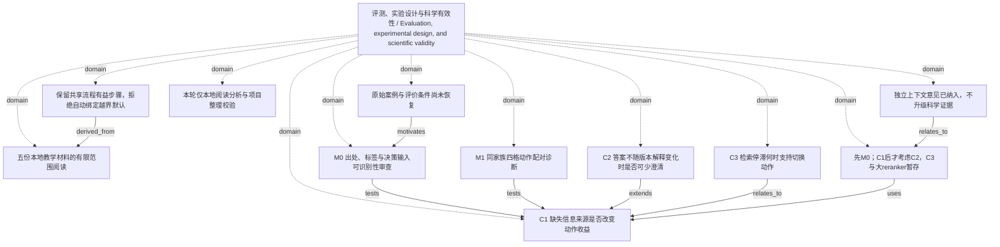

<!-- Generated by Agent Research Atlas; edit atlas.json via upsert or notes.md. -->
# 评测、实验设计与科学有效性 / Evaluation, experimental design, and scientific validity

[Atlas overview](../../MAP.md) · [Human notes](notes.md)

Coverage: **partial**

## Recorded relationships



## Evidence and exploration

### 五份本地教学材料的有限范围阅读

`explore-local-20261020` · exploration · completed_scoped_local

```json
{
  "actual_source_count": 5,
  "external_search_status": "not_run",
  "language": "zh",
  "limitations": "没有25条逐例描述或原始案例；没有真实论文、在线查询、模型/API或研究执行。result_ids为空表示没有paper记录，不表示在线查无论文。",
  "provider": "local-files / rg --files + atlas.py discover + text reading",
  "query": "在授权项目中发现地图并读取PROJECT、综述、开发观察、资源和共享工作流，区分来源陈述与研究假设",
  "report_path": "reviews/2026-10-20/source-ledger.json",
  "result_ids": [],
  "scope": "仅项目原始五文件；全部SYNTHETIC；首次discover files_examined=5,truncated=false，无既有地图",
  "searched_at": "2026-10-20",
  "source_keys": [
    "S01",
    "S02",
    "S03",
    "S04",
    "S05"
  ]
}
```

- PROJECT.md — access: local; locator: 项目说明；全文第1–5行
- surveys/overview.md — access: local; locator: 综述式定位笔记；全文第1–5行
- docs/observations.md — access: local; locator: 本地开发笔记；全文第1–5行
- docs/resources.md — access: local; locator: 已知本地条件；全文第1–3行
- notes/shared-workflow.md — access: local; locator: 共享工作流；全文第1–7行

### 原始案例与评价条件尚未恢复

`problem-missing-cases` · problem · open

```json
{
  "count_25_is_sample_size": false,
  "missing": [
    "原始案例/语料版本与权利",
    "标注/评价器",
    "可运行基线",
    "未见评测家族",
    "未来负载授权"
  ],
  "observation": "资源文件提及25条单一开发者描述且选题者已看过，但当前附属材料没有逐条描述、原案例、标签、轨迹、成本。",
  "problem": "现有材料无法完成机制归因或独立验证。"
}
```

- docs/observations.md — access: local; locator: 本地开发笔记；全文第1–5行
- docs/resources.md — access: local; locator: 已知本地条件；全文第1–3行

### C1 缺失信息来源是否改变动作收益

`c1-gap-routing` · hypothesis · proposed

```json
{
  "closest_paper_ids": [],
  "continuation": "优先M0；简单规则解释全部收益则保留诊断并停止加复杂组件。",
  "contribution_type": "候选机制边界/测量；尚非新算法",
  "depends_on": [
    "problem-information-gaps",
    "problem-missing-cases"
  ],
  "empirical_results": false,
  "falsification": "在真值、实现、可见性与比较有效且精度足够时，预测交互不出现，或收益仅存在于隐藏标签上界；后者挑战可部署版本而非信息作用的一般命题。",
  "feasibility": {
    "budget": "unavailable",
    "compute": "unverified",
    "data": "unavailable",
    "evaluation": "unavailable"
  },
  "feasibility_notes": "S04：没有已审核数据、GPU或商业API许可，本轮研究负载预算0；CPU实现/性能未核实，评价器和原例缺失。",
  "mechanism": "澄清补目标版本，检索补适用证据；只用当时可见信号选择动作。",
  "method_card_path": "docs/candidates-and-methods.md",
  "minimal_test": "先M0恢复出处与遮罩标注；通过后M1同家族四格×固定/简单策略配对比较，oracle单列。",
  "nearest_work_status": "真实论文未检索、未核验；本地方法家族不是最近论文",
  "prediction": "两个单缺口切片中，澄清相对再检索的收益方向不同；可见信号策略应与此区别对应。",
  "problem": "problem-information-gaps",
  "rival_explanations": [
    "隐藏目标/适用性标签泄漏",
    "简单版本匹配与固定提问已经充分",
    "新增信息量或自然成本不同",
    "索引/版本元数据故障",
    "选择偏差或真值歧义"
  ],
  "status_reason": "只有本地教学线索和设计；无真实近邻、可用数据/评价器/执行预算。",
  "uncertain_outcome": "原例/标签缺失、不可辨识、双方缺口一步不能消除、语料缺证据或精度不足。"
}
```

- PROJECT.md — access: local; locator: 项目说明；全文第1–5行
- surveys/overview.md — access: local; locator: 综述式定位笔记；全文第1–5行
- docs/observations.md — access: local; locator: 本地开发笔记；全文第1–5行
- docs/resources.md — access: local; locator: 已知本地条件；全文第1–3行
- docs/candidates-and-methods.md — access: local; locator: 三个候选 / 方法卡：C1

### C2 答案不随版本解释变化时是否可少澄清

`c2-answer-sensitive-clarification` · hypothesis · proposed

```json
{
  "closest_paper_ids": [],
  "continuation": "保留为C1之后的备选，不增加本轮负载。",
  "contribution_type": "澄清价值边界候选",
  "empirical_results": false,
  "falsification": "合法获取差异信号后仍无法减少无益提问，或简单条件式回答在相同任务约束下支配候选。",
  "feasibility": {
    "budget": "unavailable",
    "compute": "unverified",
    "data": "unavailable",
    "evaluation": "unavailable"
  },
  "feasibility_notes": "S04：没有已审核数据、GPU或商业API许可，本轮研究负载预算0；CPU实现/性能未核实，评价器和原例缺失。",
  "mechanism": "只有合理解释改变可接受结果且条件式回答不足时，澄清才可能增加任务价值。",
  "minimal_test": "C1之后对答案同/不同的版本解释配对；比较固定问、直接回答与带版本条件回答；差异分层仅供评价器。",
  "nearest_work_status": "真实论文未检索、未核验；本地方法家族不是最近论文",
  "prediction": "答案不变切片中不提问可能同样满足任务；答案改变切片中定向澄清才可能有益。",
  "problem": "并非所有歧义都影响任务答案；提问有用户成本。",
  "rival_explanations": [
    "候选偷看隐藏答案差异",
    "条件式答案已满足用户",
    "额外文本或保守未回答造成表面收益"
  ],
  "status_reason": "答案敏感性是本轮提出的边界假设，没有本地结果或真实近邻。",
  "uncertain_outcome": "可接受任务答案未定义，或答案差异只能由隐藏真值知道。"
}
```

- surveys/overview.md — access: local; locator: 综述式定位笔记；全文第1–5行
- docs/resources.md — access: local; locator: 已知本地条件；全文第1–3行
- docs/candidates-and-methods.md — access: local; locator: C2 与最近工作比较

### C3 检索停滞何时支持切换动作

`c3-stagnation-switch` · hypothesis · parked

```json
{
  "closest_paper_ids": [],
  "empirical_results": false,
  "falsification": "简单基线解释收益，或当前可见停滞不能区分下一步价值；未来结果不可作为输入。",
  "feasibility": {
    "budget": "unavailable",
    "compute": "unverified",
    "data": "unavailable",
    "evaluation": "unavailable"
  },
  "feasibility_notes": "S04：没有已审核数据、GPU或商业API许可，本轮研究负载预算0；CPU实现/性能未核实，评价器和原例缺失。",
  "mechanism": "当前轨迹中没有新增适用证据时，转向去重、改写或针对缺目标的澄清可能更有价值。",
  "minimal_test": "取得逐次轨迹后，对照可恢复停滞/语料缺失；比较去重+版本过滤+一次改写、固定深度上限；候选只看当前以前轨迹。",
  "nearest_work_status": "真实论文未检索、未核验；本地方法家族不是最近论文",
  "prediction": "停滞信号在可恢复与不可恢复轨迹中的价值不同，不能统一推出澄清。",
  "problem": "重复取回内容是否提供下一步动作的可靠信号？",
  "reopen_condition": "原始轨迹与标签到位、C1判别完成且未来负载获授权。",
  "rival_explanations": [
    "后续仍可能取回有效新证据",
    "语料根本没有证据",
    "排序/查询实现故障",
    "重复证据不等于任务充分"
  ],
  "status_reason": "只有重复两次旧片段的教学描述，核心轨迹缺失，优先级低于M0；不是被反驳。",
  "uncertain_outcome": "没有逐次轨迹、有效性真值或实际成本。"
}
```

- docs/observations.md — access: local; locator: 本地开发笔记；全文第1–5行
- docs/resources.md — access: local; locator: 已知本地条件；全文第1–3行
- docs/candidates-and-methods.md — access: local; locator: C3 / 遗留方向与本轮决定

### M0 出处、标签与决策输入可识别性审查

`design-m0-identifiability` · experiment · designed_not_run

```json
{
  "artifact_path": "plans/minimal-discriminating-study.md",
  "blocked_by": [
    "数据与权利未核实",
    "标注/评价器缺失",
    "本轮不允许执行研究负载"
  ],
  "depends_on": [
    "problem-missing-cases",
    "c1-gap-routing"
  ],
  "executed": false,
  "frozen": false,
  "next": "恢复原例与版本链，遮住目标/有效性真值做独立标注，保留unknown和分歧。",
  "question": "两个失败解释能否由可核对信息区分，路由时是否可见？",
  "record_kind": "design_only_not_result",
  "research_runs": 0,
  "unit": "具有完整出处的文档家族；四变体配对，不是四个独立样本。"
}
```

- docs/observations.md — access: local; locator: 本地开发笔记；全文第1–5行
- docs/resources.md — access: local; locator: 已知本地条件；全文第1–3行
- plans/minimal-discriminating-study.md — access: local; locator: M0全节

### M1 同家族四格动作配对诊断

`design-m1-crossed-diagnostic` · experiment · designed_not_run

```json
{
  "artifact_path": "plans/minimal-discriminating-study.md",
  "cost_limit": "一问与一检索不是相同自然成本，分别记录。",
  "depends_on": [
    "design-m0-identifiability",
    "c1-gap-routing"
  ],
  "executed": false,
  "frozen": false,
  "oracle_limit": "隐藏状态仅用于诊断上界，不能算部署方法。",
  "primary_observation": "动作后目标绑定与有效证据缺口是否消除；没有生成器时不称QA准确率。",
  "question": "动作收益是否随缺口类型变化，简单规则是否已经足够？",
  "record_kind": "design_only_not_result",
  "research_runs": 0,
  "unit": "family；四变体和多次采样不增加独立家族。"
}
```

- docs/resources.md — access: local; locator: 已知本地条件；全文第1–3行
- plans/minimal-discriminating-study.md — access: local; locator: M1全节 / 资源与执行交接

### 先M0；C1后才考虑C2，C3与大reranker暂存

`decision-prioritize-m0` · decision · current

```json
{
  "decision": "先解决最影响后续选择的数据/标签/可见性缺口。",
  "depends_on": [
    "c1-gap-routing",
    "c2-answer-sensitive-clarification",
    "c3-stagnation-switch",
    "legacy-large-reranker"
  ],
  "next": "在未来输入与授权具备时按M0恢复并检查；本轮交付后停止。",
  "reason": "现有材料不能判断原因，且两种缺口可能在决策时纠缠；简单版本规则可能已经充分。"
}
```

- surveys/overview.md — access: local; locator: 综述式定位笔记；全文第1–5行
- docs/observations.md — access: local; locator: 本地开发笔记；全文第1–5行
- docs/resources.md — access: local; locator: 已知本地条件；全文第1–3行
- docs/candidates-and-methods.md — access: local; locator: 遗留方向与本轮决定

### 保留共享流程有益步骤，拒绝自动绑定越界默认

`decision-workflow-selection` · decision · current

```json
{
  "capability_lookup": [
    "C08",
    "C12"
  ],
  "conflict_contracts": [
    "CF04",
    "CF15"
  ],
  "reason": "第三方工作流为待评估内容；固定框架/分数不是科学依据，不改变用户授权。",
  "reject": [
    "清空目录",
    "机械十框架四十候选",
    "8.5评分自动认定创新",
    "付费云作业和全部安装",
    "自动公开数据"
  ],
  "retain": [
    "稳定问题锚点",
    "固定/可变条件",
    "竞争解释",
    "早期分支测试"
  ]
}
```

- docs/resources.md — access: local; locator: 已知本地条件；全文第1–3行
- notes/shared-workflow.md — access: local; locator: 共享工作流；全文第1–7行
- docs/candidates-and-methods.md — access: local; locator: 共享工作流逐项取舍

### 本轮仅本地阅读分析与项目整理校验

`decision-boundary` · decision · current

```json
{
  "allowed": "只在该项目整理地图、候选、方法取舍、最小方案、交接与校验",
  "forbidden": "网络、安装、研究负载、付费、公开、修改技能源文件",
  "installations": 0,
  "network_calls": 0,
  "paid_calls": 0,
  "publications": 0,
  "reason": "按用户明确范围与S04资源条件执行；没有伪造可执行plan/freeze/run。",
  "research_load_budget": 0
}
```

- PROJECT.md — access: local; locator: 项目说明；全文第1–5行
- docs/resources.md — access: local; locator: 已知本地条件；全文第1–3行
- docs/problem-anchor.md — access: local; locator: 保持与可调整的条件 / 本轮成功条件

### 独立上下文意见已纳入，不升级科学证据

`decision-independent-review` · decision · current

```json
{
  "changes": [
    "加入可见性遮罩和oracle分离",
    "目标旧版本边界",
    "强简单规则",
    "家族配对与未解决状态",
    "自然成本分列",
    "C2条件式答案对照",
    "C3可恢复停滞反例"
  ],
  "independence_limit": "独立上下文提案质疑；共享材料/候选，审阅者此前接触另一同主题项目；不是盲评或独立科学复验。",
  "proposal_author": "/root/cold_method_selection",
  "read_scope": "五份项目原始材料全文；收到C1/C2/C3描述，无希望其得出的判决",
  "reviewer": "/root/cold_evidence_review"
}
```

- PROJECT.md — access: local; locator: 项目说明；全文第1–5行
- surveys/overview.md — access: local; locator: 综述式定位笔记；全文第1–5行
- docs/observations.md — access: local; locator: 本地开发笔记；全文第1–5行
- docs/resources.md — access: local; locator: 已知本地条件；全文第1–3行
- notes/shared-workflow.md — access: local; locator: 共享工作流；全文第1–7行
- reviews/2026-10-20/independent-review.md — access: local; locator: 全文

