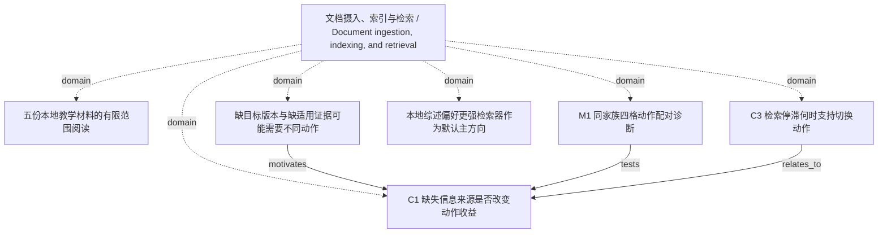

<!-- Generated by Agent Research Atlas; edit atlas.json via upsert or notes.md. -->
# 文档摄入、索引与检索 / Document ingestion, indexing, and retrieval

[Atlas overview](../../MAP.md) · [Human notes](notes.md)

Coverage: **partial**

## Recorded relationships



## Evidence and exploration

### 五份本地教学材料的有限范围阅读

`explore-local-20261020` · exploration · completed_scoped_local

```json
{
  "actual_source_count": 5,
  "external_search_status": "not_run",
  "language": "zh",
  "limitations": "没有25条逐例描述或原始案例；没有真实论文、在线查询、模型/API或研究执行。result_ids为空表示没有paper记录，不表示在线查无论文。",
  "provider": "local-files / rg --files + atlas.py discover + text reading",
  "query": "在授权项目中发现地图并读取PROJECT、综述、开发观察、资源和共享工作流，区分来源陈述与研究假设",
  "report_path": "reviews/2026-10-20/source-ledger.json",
  "result_ids": [],
  "scope": "仅项目原始五文件；全部SYNTHETIC；首次discover files_examined=5,truncated=false，无既有地图",
  "searched_at": "2026-10-20",
  "source_keys": [
    "S01",
    "S02",
    "S03",
    "S04",
    "S05"
  ]
}
```

- PROJECT.md — access: local; locator: 项目说明；全文第1–5行
- surveys/overview.md — access: local; locator: 综述式定位笔记；全文第1–5行
- docs/observations.md — access: local; locator: 本地开发笔记；全文第1–5行
- docs/resources.md — access: local; locator: 已知本地条件；全文第1–3行
- notes/shared-workflow.md — access: local; locator: 共享工作流；全文第1–7行

### 缺目标版本与缺适用证据可能需要不同动作

`problem-information-gaps` · problem · open

```json
{
  "boundary": "目标版本可能是旧版本；目标未知时适用性标签也可能不可见；两种缺口可并存。",
  "consequence": "如果区分不成立或不可观测，盲目增加检索/提问组件不能构成已证研究机制。",
  "evidence_status": "synthetic_description_only",
  "observation": "开发笔记仅提出两类失败线索，没有逐例验证。",
  "problem": "从现有输入能否区分用户目标版本未定与证据不适用，并据此选择回答/检索/澄清？"
}
```

- PROJECT.md — access: local; locator: 项目说明；全文第1–5行
- surveys/overview.md — access: local; locator: 综述式定位笔记；全文第1–5行
- docs/observations.md — access: local; locator: 本地开发笔记；全文第1–5行

### C1 缺失信息来源是否改变动作收益

`c1-gap-routing` · hypothesis · proposed

```json
{
  "closest_paper_ids": [],
  "continuation": "优先M0；简单规则解释全部收益则保留诊断并停止加复杂组件。",
  "contribution_type": "候选机制边界/测量；尚非新算法",
  "depends_on": [
    "problem-information-gaps",
    "problem-missing-cases"
  ],
  "empirical_results": false,
  "falsification": "在真值、实现、可见性与比较有效且精度足够时，预测交互不出现，或收益仅存在于隐藏标签上界；后者挑战可部署版本而非信息作用的一般命题。",
  "feasibility": {
    "budget": "unavailable",
    "compute": "unverified",
    "data": "unavailable",
    "evaluation": "unavailable"
  },
  "feasibility_notes": "S04：没有已审核数据、GPU或商业API许可，本轮研究负载预算0；CPU实现/性能未核实，评价器和原例缺失。",
  "mechanism": "澄清补目标版本，检索补适用证据；只用当时可见信号选择动作。",
  "method_card_path": "docs/candidates-and-methods.md",
  "minimal_test": "先M0恢复出处与遮罩标注；通过后M1同家族四格×固定/简单策略配对比较，oracle单列。",
  "nearest_work_status": "真实论文未检索、未核验；本地方法家族不是最近论文",
  "prediction": "两个单缺口切片中，澄清相对再检索的收益方向不同；可见信号策略应与此区别对应。",
  "problem": "problem-information-gaps",
  "rival_explanations": [
    "隐藏目标/适用性标签泄漏",
    "简单版本匹配与固定提问已经充分",
    "新增信息量或自然成本不同",
    "索引/版本元数据故障",
    "选择偏差或真值歧义"
  ],
  "status_reason": "只有本地教学线索和设计；无真实近邻、可用数据/评价器/执行预算。",
  "uncertain_outcome": "原例/标签缺失、不可辨识、双方缺口一步不能消除、语料缺证据或精度不足。"
}
```

- PROJECT.md — access: local; locator: 项目说明；全文第1–5行
- surveys/overview.md — access: local; locator: 综述式定位笔记；全文第1–5行
- docs/observations.md — access: local; locator: 本地开发笔记；全文第1–5行
- docs/resources.md — access: local; locator: 已知本地条件；全文第1–3行
- docs/candidates-and-methods.md — access: local; locator: 三个候选 / 方法卡：C1

### C3 检索停滞何时支持切换动作

`c3-stagnation-switch` · hypothesis · parked

```json
{
  "closest_paper_ids": [],
  "empirical_results": false,
  "falsification": "简单基线解释收益，或当前可见停滞不能区分下一步价值；未来结果不可作为输入。",
  "feasibility": {
    "budget": "unavailable",
    "compute": "unverified",
    "data": "unavailable",
    "evaluation": "unavailable"
  },
  "feasibility_notes": "S04：没有已审核数据、GPU或商业API许可，本轮研究负载预算0；CPU实现/性能未核实，评价器和原例缺失。",
  "mechanism": "当前轨迹中没有新增适用证据时，转向去重、改写或针对缺目标的澄清可能更有价值。",
  "minimal_test": "取得逐次轨迹后，对照可恢复停滞/语料缺失；比较去重+版本过滤+一次改写、固定深度上限；候选只看当前以前轨迹。",
  "nearest_work_status": "真实论文未检索、未核验；本地方法家族不是最近论文",
  "prediction": "停滞信号在可恢复与不可恢复轨迹中的价值不同，不能统一推出澄清。",
  "problem": "重复取回内容是否提供下一步动作的可靠信号？",
  "reopen_condition": "原始轨迹与标签到位、C1判别完成且未来负载获授权。",
  "rival_explanations": [
    "后续仍可能取回有效新证据",
    "语料根本没有证据",
    "排序/查询实现故障",
    "重复证据不等于任务充分"
  ],
  "status_reason": "只有重复两次旧片段的教学描述，核心轨迹缺失，优先级低于M0；不是被反驳。",
  "uncertain_outcome": "没有逐次轨迹、有效性真值或实际成本。"
}
```

- docs/observations.md — access: local; locator: 本地开发笔记；全文第1–5行
- docs/resources.md — access: local; locator: 已知本地条件；全文第1–3行
- docs/candidates-and-methods.md — access: local; locator: C3 / 遗留方向与本轮决定

### 本地综述偏好更强检索器作为默认主方向

`claim-retriever-default` · claim · unsupported

```json
{
  "limitations": "S02为SYNTHETIC且无控制实验或可计算数据；unsupported不等于已被反驳。",
  "reasoning": "该推荐缺少比较证据；记录为来源偏好，不能作为当前科学结论。",
  "statement": "本地定位笔记推荐默认优先更强检索器。",
  "status_reason": "保留来源原意，同时明确不采用无证据默认优先级。"
}
```

- surveys/overview.md — access: local; locator: 综述式定位笔记；全文第1–5行

### M1 同家族四格动作配对诊断

`design-m1-crossed-diagnostic` · experiment · designed_not_run

```json
{
  "artifact_path": "plans/minimal-discriminating-study.md",
  "cost_limit": "一问与一检索不是相同自然成本，分别记录。",
  "depends_on": [
    "design-m0-identifiability",
    "c1-gap-routing"
  ],
  "executed": false,
  "frozen": false,
  "oracle_limit": "隐藏状态仅用于诊断上界，不能算部署方法。",
  "primary_observation": "动作后目标绑定与有效证据缺口是否消除；没有生成器时不称QA准确率。",
  "question": "动作收益是否随缺口类型变化，简单规则是否已经足够？",
  "record_kind": "design_only_not_result",
  "research_runs": 0,
  "unit": "family；四变体和多次采样不增加独立家族。"
}
```

- docs/resources.md — access: local; locator: 已知本地条件；全文第1–3行
- plans/minimal-discriminating-study.md — access: local; locator: M1全节 / 资源与执行交接

