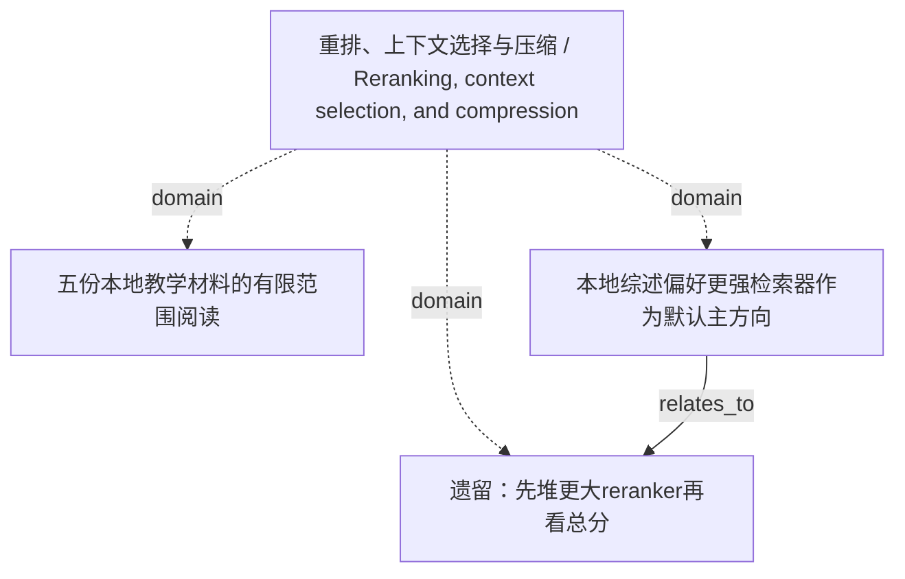

<!-- Generated by Agent Research Atlas; edit atlas.json via upsert or notes.md. -->
# 重排、上下文选择与压缩 / Reranking, context selection, and compression

[Atlas overview](../../MAP.md) · [Human notes](notes.md)

Coverage: **partial**

## Recorded relationships



## Evidence and exploration

### 五份本地教学材料的有限范围阅读

`explore-local-20261020` · exploration · completed_scoped_local

```json
{
  "actual_source_count": 5,
  "external_search_status": "not_run",
  "language": "zh",
  "limitations": "没有25条逐例描述或原始案例；没有真实论文、在线查询、模型/API或研究执行。result_ids为空表示没有paper记录，不表示在线查无论文。",
  "provider": "local-files / rg --files + atlas.py discover + text reading",
  "query": "在授权项目中发现地图并读取PROJECT、综述、开发观察、资源和共享工作流，区分来源陈述与研究假设",
  "report_path": "reviews/2026-10-20/source-ledger.json",
  "result_ids": [],
  "scope": "仅项目原始五文件；全部SYNTHETIC；首次discover files_examined=5,truncated=false，无既有地图",
  "searched_at": "2026-10-20",
  "source_keys": [
    "S01",
    "S02",
    "S03",
    "S04",
    "S05"
  ]
}
```

- PROJECT.md — access: local; locator: 项目说明；全文第1–5行
- surveys/overview.md — access: local; locator: 综述式定位笔记；全文第1–5行
- docs/observations.md — access: local; locator: 本地开发笔记；全文第1–5行
- docs/resources.md — access: local; locator: 已知本地条件；全文第1–3行
- notes/shared-workflow.md — access: local; locator: 共享工作流；全文第1–7行

### 遗留：先堆更大reranker再看总分

`legacy-large-reranker` · hypothesis · parked

```json
{
  "closest_paper_ids": [],
  "empirical_results": false,
  "falsification": "有效对照显示容量变化未修目标失效；当前没有这样的证据。",
  "feasibility": {
    "budget": "unavailable",
    "compute": "unverified",
    "data": "unavailable",
    "evaluation": "unavailable"
  },
  "feasibility_notes": "S04：没有已审核数据、GPU或商业API许可，本轮研究负载预算0；CPU实现/性能未核实，评价器和原例缺失。",
  "mechanism": "更强重排可能改善证据选择，实际针对的瓶颈未核实。",
  "minimal_test": "先M0定位是否存在排序/装配瓶颈，再定义与简单版本过滤的针对性比较。",
  "nearest_work_status": "真实论文未检索、未核验；本地方法家族不是最近论文",
  "prediction": "若正确版本已召回但被排序/装配压制，重排变化可能改善支持证据。",
  "problem": "开发笔记遗留的容量优先想法，尚未实施。",
  "reopen_condition": "正确版本已召回但被排序/上下文选择压制，且简单过滤不足；资源与执行条件已核实。",
  "rival_explanations": [
    "目标本身未明确",
    "正确版本未入库或未召回",
    "简单版本过滤足够",
    "只增加资源不修原因"
  ],
  "status_reason": "保留原想法，因无机制定位/比较/资源而暂存；未运行、未被科学反驳。"
}
```

- surveys/overview.md — access: local; locator: 综述式定位笔记；全文第1–5行
- docs/observations.md — access: local; locator: 本地开发笔记；全文第1–5行
- docs/resources.md — access: local; locator: 已知本地条件；全文第1–3行

### 本地综述偏好更强检索器作为默认主方向

`claim-retriever-default` · claim · unsupported

```json
{
  "limitations": "S02为SYNTHETIC且无控制实验或可计算数据；unsupported不等于已被反驳。",
  "reasoning": "该推荐缺少比较证据；记录为来源偏好，不能作为当前科学结论。",
  "statement": "本地定位笔记推荐默认优先更强检索器。",
  "status_reason": "保留来源原意，同时明确不采用无证据默认优先级。"
}
```

- surveys/overview.md — access: local; locator: 综述式定位笔记；全文第1–5行

