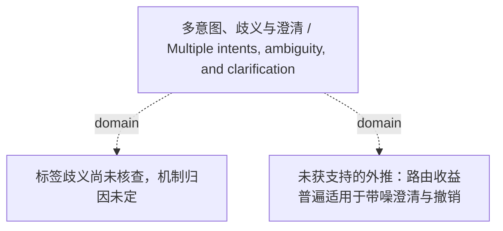

<!-- Generated by Agent Research Atlas; edit atlas.json via upsert or notes.md. -->
# 多意图、歧义与澄清 / Multiple intents, ambiguity, and clarification

[Atlas overview](../../MAP.md) · [Human notes](notes.md)

Coverage: **unsearched**

## Recorded relationships



## Evidence and exploration

### 标签歧义尚未核查，机制归因未定

`problem-label-ambiguity-unresolved` · problem · open

```json
{
  "depends_on": [
    "past-decision"
  ],
  "next_check": "Read/adjudicate label definitions and timing semantics before modifying routing keywords.",
  "observation_scope": "Existing project decision, not a measured experiment",
  "problem": "Labels may be ambiguous; the project has not established model failure or execution failure.",
  "status_reason": "Preserve the original diagnostic prerequisite."
}
```

- seed-batch.json — access: local; locator: nodes[id=past-decision]
- docs/RESEARCH-DIRECTION.md — access: local; locator: sections 3–4

### 未获支持的外推：路由收益普遍适用于带噪澄清与撤销

`claim-broad-routing-extrapolation` · claim · unsupported

```json
{
  "claim_under_review": "Unqualified extrapolation of the synthetic routing advantage to noisy clarification and revocation tasks.",
  "evidence_ids": [
    "local-support",
    "local-counter"
  ],
  "limitations": "Synthetic texts only; no quantified result or real paper identity.",
  "reasoning": "The counter excerpt explicitly introduces a failure condition; neither excerpt reports a temporal-intent/revocation experiment. This is an unsupported extrapolation record, not a real empirical refutation of H1.",
  "statement": "固定动作预算下的不确定性路由收益普遍适用于带噪澄清、时变意图和撤销任务。",
  "statement_origin": "Project extrapolation under critique; not a quotation or attributed claim from a real paper.",
  "status_reason": "Semantic review aligned the claim statement with the incoming contradicts edge: the positive extrapolation is the object under critique; unsupported does not mean an empirical refutation of H1.",
  "wording_decision": "Do not adopt this statement: noisy-clarification counterevidence challenges its unqualified scope, and no temporal-intent/revocation result is available."
}
```

- docs/EVIDENCE-LEDGER.md — access: local; locator: support, counterevidence and extrapolation boundaries

