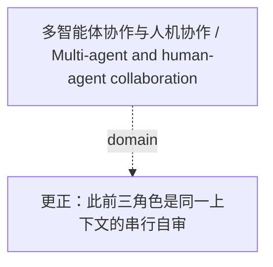

<!-- Generated by Agent Research Atlas; edit atlas.json via upsert or notes.md. -->
# 多智能体协作与人机协作 / Multi-agent and human-agent collaboration

[Atlas overview](../../MAP.md) · [Human notes](notes.md)

Coverage: **unsearched**

## Recorded relationships



## Evidence and exploration

### 更正：此前三角色是同一上下文的串行自审

`decision-review-provenance-corrected` · decision · recorded

```json
{
  "current_interpretation": "The prior generator/reviewer/statistician roles were played in one context; independent reviewer agreement is unsupported.",
  "independent_review_count_verified": 0,
  "old_claim": "三位独立评审一致认可",
  "review_type_this_turn": "single executing-agent local analysis/self-review; handoff review, if any, must be recorded separately",
  "status_reason": "Role names do not create independent evidence; original wording remains archived."
}
```

- docs/history/team-note-original-2026-10-20.md — access: local; locator: line 4
- docs/team-note.md — access: local; locator: 2026-10-20 correction section
- docs/EVIDENCE-LEDGER.md — access: local; locator: review provenance correction

