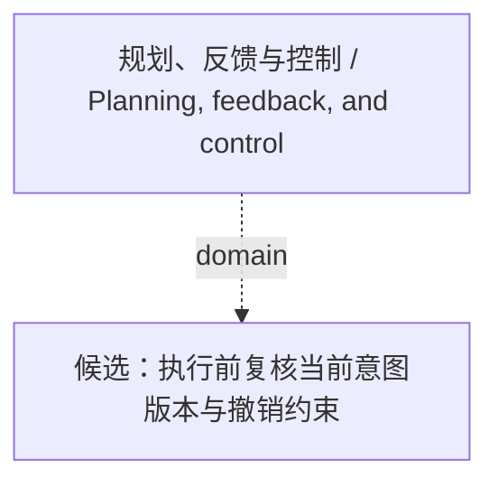

<!-- Generated by Agent Research Atlas; edit atlas.json via upsert or notes.md. -->
# 规划、反馈与控制 / Planning, feedback, and control

[Atlas overview](../../MAP.md) · [Human notes](notes.md)

Coverage: **unsearched**

## Recorded relationships



## Evidence and exploration

### 候选：执行前复核当前意图版本与撤销约束

`hyp-versioned-intent-execution-gate` · hypothesis · proposed

```json
{
  "artifact_path": "docs/RESEARCH-DIRECTION.md",
  "closest_paper_ids": [],
  "closest_work_status": "unresolved: local-support/local-counter are synthetic, not verified nearest real papers",
  "depends_on": [
    "problem-stale-intent-at-dispatch",
    "problem-label-ambiguity-unresolved",
    "local-support",
    "local-counter"
  ],
  "evidence_ids": [],
  "falsification": "Narrow or park the method claim if corrected labels or strong rules explain the effect, improvements depend on stopping legitimate tasks, or equal-information/budget comparisons eliminate the predicted difference. Do not call a low-precision null equivalence.",
  "feasibility": {
    "budget": "unavailable",
    "compute": "unverified",
    "data": "unavailable",
    "evaluation": "unverified"
  },
  "feasibility_notes": "Only synthetic teaching excerpts exist; no verified real trajectories, evaluation environment or experimental resources. This turn authorizes local analysis/validation only and a zero paid budget, not research execution.",
  "mechanism": "Recheck effective scope, intent version and cancellation state at the execution boundary; identify whether this adds value beyond correct labels, simple current-state rules and extra waiting.",
  "minimal_test": "First audit labels and event semantics; then hold correct intent and budget fixed and compare route-time-only checking, strong deterministic cancellation and version/scope rechecking. Add noisy clarification only after the earlier blocks discriminate the mechanism.",
  "motivation_excerpt_ids": [
    "local-support",
    "local-counter"
  ],
  "prediction": "Within preventable actions with revocation already visible, a correctly implemented execution check may reduce stale side effects under matched information and budget while preserving legitimate task utility.",
  "problem": "After an authoritative goal update/revocation, a pending action may still be based on stale constraints.",
  "rival_explanations": [
    "Ambiguous labels or incorrect intent decoding",
    "A strong deterministic cancellation rule already solves the case",
    "Extra calls, clarification, latency or abstention explain apparent gains",
    "Revocation arrived after commitment",
    "A check-then-act race defeats a non-atomic guard",
    "Noisy clarification increases mis-cancellation"
  ],
  "status_reason": "Proposed only: no real nearest-paper/fulltext audit or research experiment, and feasibility remains unresolved.",
  "unknowns": [
    "Real prior work and contribution overlap",
    "Data/license/label validity",
    "Execution/commit boundary",
    "Minimum useful effect and sample/uncertainty design"
  ]
}
```

- docs/RESEARCH-DIRECTION.md — access: local; locator: sections 4–7
- papers/support.md — access: local; locator: line 1; synthetic motivation only
- papers/counter.md — access: local; locator: line 1; synthetic boundary challenge only

