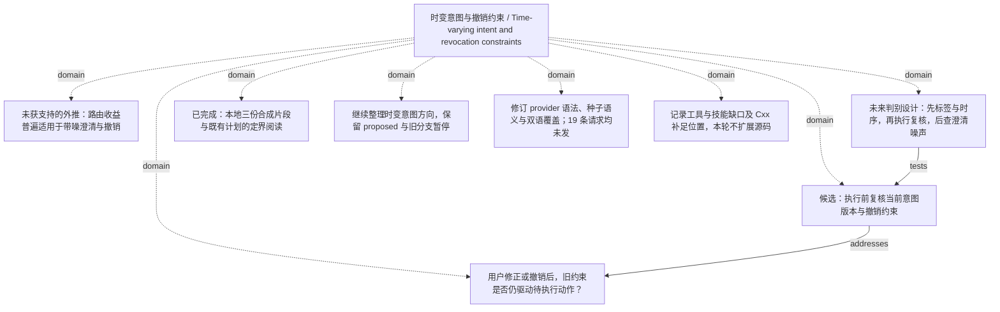

<!-- Generated by Agent Research Atlas; edit atlas.json via upsert or notes.md. -->
# 时变意图与撤销约束 / Time-varying intent and revocation constraints

[Atlas overview](../../MAP.md) · [Human notes](notes.md)

Coverage: **unsearched**

## Recorded relationships



## Evidence and exploration

### 用户修正或撤销后，旧约束是否仍驱动待执行动作？

`problem-stale-intent-at-dispatch` · problem · candidate

```json
{
  "boundary": "Only authoritative updates visible before the environment-specific preventable-action boundary.",
  "observed_in_real_system": false,
  "origin": "Hypothesis-generating inference from the project goal and synthetic support/counterexample, not a measured failure.",
  "problem": "Distinguish intent decoding, update propagation, execution-time checking and already committed actions when goals/authorization change.",
  "unknowns": [
    "Real closest prior art",
    "Actual action commitment semantics",
    "Correct label source",
    "Real prevalence and magnitude"
  ]
}
```

- docs/RESEARCH-DIRECTION.md — access: local; locator: sections 1–4
- docs/history/team-note-original-2026-10-20.md — access: local; locator: project goal

### 候选：执行前复核当前意图版本与撤销约束

`hyp-versioned-intent-execution-gate` · hypothesis · proposed

```json
{
  "artifact_path": "docs/RESEARCH-DIRECTION.md",
  "closest_paper_ids": [],
  "closest_work_status": "unresolved: local-support/local-counter are synthetic, not verified nearest real papers",
  "depends_on": [
    "problem-stale-intent-at-dispatch",
    "problem-label-ambiguity-unresolved",
    "local-support",
    "local-counter"
  ],
  "evidence_ids": [],
  "falsification": "Narrow or park the method claim if corrected labels or strong rules explain the effect, improvements depend on stopping legitimate tasks, or equal-information/budget comparisons eliminate the predicted difference. Do not call a low-precision null equivalence.",
  "feasibility": {
    "budget": "unavailable",
    "compute": "unverified",
    "data": "unavailable",
    "evaluation": "unverified"
  },
  "feasibility_notes": "Only synthetic teaching excerpts exist; no verified real trajectories, evaluation environment or experimental resources. This turn authorizes local analysis/validation only and a zero paid budget, not research execution.",
  "mechanism": "Recheck effective scope, intent version and cancellation state at the execution boundary; identify whether this adds value beyond correct labels, simple current-state rules and extra waiting.",
  "minimal_test": "First audit labels and event semantics; then hold correct intent and budget fixed and compare route-time-only checking, strong deterministic cancellation and version/scope rechecking. Add noisy clarification only after the earlier blocks discriminate the mechanism.",
  "motivation_excerpt_ids": [
    "local-support",
    "local-counter"
  ],
  "prediction": "Within preventable actions with revocation already visible, a correctly implemented execution check may reduce stale side effects under matched information and budget while preserving legitimate task utility.",
  "problem": "After an authoritative goal update/revocation, a pending action may still be based on stale constraints.",
  "rival_explanations": [
    "Ambiguous labels or incorrect intent decoding",
    "A strong deterministic cancellation rule already solves the case",
    "Extra calls, clarification, latency or abstention explain apparent gains",
    "Revocation arrived after commitment",
    "A check-then-act race defeats a non-atomic guard",
    "Noisy clarification increases mis-cancellation"
  ],
  "status_reason": "Proposed only: no real nearest-paper/fulltext audit or research experiment, and feasibility remains unresolved.",
  "unknowns": [
    "Real prior work and contribution overlap",
    "Data/license/label validity",
    "Execution/commit boundary",
    "Minimum useful effect and sample/uncertainty design"
  ]
}
```

- docs/RESEARCH-DIRECTION.md — access: local; locator: sections 4–7
- papers/support.md — access: local; locator: line 1; synthetic motivation only
- papers/counter.md — access: local; locator: line 1; synthetic boundary challenge only

### 未获支持的外推：路由收益普遍适用于带噪澄清与撤销

`claim-broad-routing-extrapolation` · claim · unsupported

```json
{
  "claim_under_review": "Unqualified extrapolation of the synthetic routing advantage to noisy clarification and revocation tasks.",
  "evidence_ids": [
    "local-support",
    "local-counter"
  ],
  "limitations": "Synthetic texts only; no quantified result or real paper identity.",
  "reasoning": "The counter excerpt explicitly introduces a failure condition; neither excerpt reports a temporal-intent/revocation experiment. This is an unsupported extrapolation record, not a real empirical refutation of H1.",
  "statement": "固定动作预算下的不确定性路由收益普遍适用于带噪澄清、时变意图和撤销任务。",
  "statement_origin": "Project extrapolation under critique; not a quotation or attributed claim from a real paper.",
  "status_reason": "Semantic review aligned the claim statement with the incoming contradicts edge: the positive extrapolation is the object under critique; unsupported does not mean an empirical refutation of H1.",
  "wording_decision": "Do not adopt this statement: noisy-clarification counterevidence challenges its unqualified scope, and no temporal-intent/revocation result is available."
}
```

- docs/EVIDENCE-LEDGER.md — access: local; locator: support, counterevidence and extrapolation boundaries

### 未来判别设计：先标签与时序，再执行复核，后查澄清噪声

`design-temporal-revocation-diagnostic` · experiment · design_only_not_executed

```json
{
  "artifact_kind": "design_document_not_run_record",
  "artifact_path": "docs/RESEARCH-DIRECTION.md",
  "depends_on": [
    "hyp-versioned-intent-execution-gate"
  ],
  "executed": false,
  "hypothesis_ids": [
    "hyp-versioned-intent-execution-gate"
  ],
  "result_artifact": null,
  "run_id": null,
  "scope": "Sections 5–7 specify comparisons, units, outcomes and unresolved resources; no code, freeze or experiment was executed.",
  "status_reason": "Planning is within authorization; research load is not."
}
```

- docs/RESEARCH-DIRECTION.md — access: local; locator: sections 5–7

### 已完成：本地三份合成片段与既有计划的定界阅读

`explore-local-corpus-2026-10-20` · exploration · completed_local_only

```json
{
  "artifact_path": "docs/EVIDENCE-LEDGER.md",
  "excluded_ids": [
    "local-irrelevant"
  ],
  "exclusion_reason": "Fruit color grading has no relevant decision-agent mechanism.",
  "executed": true,
  "external_requests": 0,
  "language": "mixed",
  "limitations": "Not a real literature search; synthetic identities, missing fulltext/methods/results, external coverage absent.",
  "provider": "local_file_reading",
  "query": "Read the supplied local support, counterexample, irrelevant excerpt, existing atlas, routing notes, team note and planned requests; classify support/counterevidence/exclusion.",
  "result_ids": [
    "local-support",
    "local-counter"
  ],
  "scope": "local_corpus: three synthetic one-line excerpts plus supplied project records; no external literature discovery",
  "screened_ids": [
    "local-support",
    "local-counter",
    "local-irrelevant"
  ],
  "searched_at": "2026-10-20"
}
```

- docs/EVIDENCE-LEDGER.md — access: local; locator: whole ledger
- docs/history/requests-original-2026-10-20.json — access: local; locator: whole original request plan
- docs/history/team-note-original-2026-10-20.md — access: local; locator: whole original note

### 继续整理时变意图方向，保留 proposed 与旧分支暂停

`decision-continue-temporal-slice` · decision · recorded

```json
{
  "decision": "Continue bounded exploration and real-nearest-work planning; do not claim novelty or execute research.",
  "depends_on": [
    "hyp-versioned-intent-execution-gate",
    "past-decision",
    "claim-broad-routing-extrapolation"
  ],
  "next_action": "Use bilingual counterevidence and adjacent-mechanism queries only if actual retrieval later becomes authorized; otherwise continue with newly supplied local material.",
  "status_reason": "The local support and counterexample motivate a timing/constraint question but do not resolve scientific feasibility."
}
```

- docs/RESEARCH-DIRECTION.md — access: local; locator: sections 6–7
- docs/RETRIEVAL-PLAN.md — access: local; locator: scope and matrix

### 修订 provider 语法、种子语义与双语覆盖；19 条请求均未发

`decision-retrieval-plan-revised` · decision · planned

```json
{
  "depends_on": [
    "local-support",
    "local-counter",
    "local-irrelevant"
  ],
  "executed": false,
  "planned_request_count": 19,
  "real_request_count": 0,
  "request_artifact": "docs/requests.json",
  "scope": "Plan only, no search result.",
  "status_reason": "Fix generic Boolean use, exclusion of counterevidence, synthetic external IDs and Elicit mode/filters mismatch.",
  "superseded_artifact": "docs/history/requests-original-2026-10-20.json"
}
```

- docs/requests.json — access: local; locator: planned_requests and execution_receipt
- docs/RETRIEVAL-PLAN.md — access: local; locator: sections 3–5

### 记录工具与技能缺口及 Cxx 补足位置，本轮不扩展源码

`decision-capability-gap-routing` · decision · recorded

```json
{
  "artifact_path": "docs/CAPABILITY-GAPS.md",
  "audit_artifact": "docs/audit/provider-extension-local.json",
  "capability_ids": [
    "C01",
    "C02",
    "C03",
    "C04",
    "C05",
    "C06",
    "C09",
    "C11",
    "C13",
    "C17",
    "C19",
    "C20",
    "C22",
    "C23",
    "C24"
  ],
  "status_reason": "Optional adapters and query planning do not establish authenticated retrieval or research coverage; local project fallbacks are used."
}
```

- docs/CAPABILITY-GAPS.md — access: local; locator: capability mapping and acceptance requirements
- docs/audit/provider-extension-local.json — access: local; locator: selected local source features/conflicts
- docs/audit/registry-check.json — access: local; locator: stdout valid/meaning

