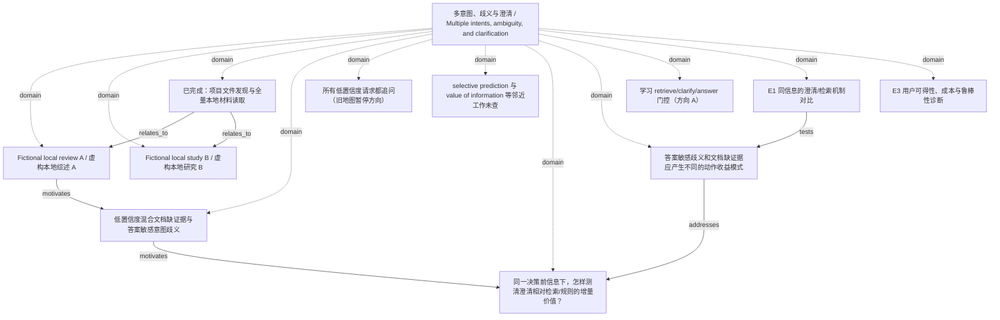

<!-- Generated by Agent Research Atlas; edit atlas.json via upsert or notes.md. -->
# 多意图、歧义与澄清 / Multiple intents, ambiguity, and clarification

[Atlas overview](../../MAP.md) · [Human notes](notes.md)

Coverage: **partial**

## Recorded relationships



## Evidence and exploration

### Fictional local review A / 虚构本地综述 A

`fixture-review-a` · paper · synthetic_fixture

```json
{
  "claims": [
    "固定意图例子未描述约束修正",
    "在供应例子中补检索可补证据，无法揭示未表明偏好",
    "比较取决于决策前可用信息"
  ],
  "limitations": "非真实发表研究；无实验原数据或检索边界",
  "publication_status": "fictional_not_published",
  "read_depth": "full_supplied_note",
  "synthetic_context": true
}
```

- papers/local-review.md — access: local; locator: Sections 1–3 (L4–6); full supplied fictional note

### Fictional local study B / 虚构本地研究 B

`fixture-study-b` · paper · synthetic_fixture

```json
{
  "claims": [
    "明确旧版本可用确定性过滤",
    "真正未指定且答案敏感的版本可通过澄清改变答案",
    "生产频率与用户容忍度未测"
  ],
  "limitations": "非真实发表研究；不证明所有歧义都值得问",
  "publication_status": "fictional_not_published",
  "read_depth": "full_supplied_note",
  "synthetic_context": true
}
```

- papers/local-counterexample.md — access: local; locator: Sections 1–3 (L4–6); full supplied fictional note

### 已完成：项目文件发现与全量本地材料读取

`explore-local-inputs-20261021` · exploration · completed_local_only

```json
{
  "artifact_path": "design/evidence-synthesis.md",
  "language": "mixed",
  "limitations": "无网络、无真实论文核验；逐行64例、文档、标签不在本次可见输入中；非全域综述",
  "provider": "local_filesystem",
  "query": "atlas discover --root PROJECT; rg --files PROJECT; read all seven supplied content files and INPUT-MANIFEST.json",
  "result_ids": [
    "fixture-review-a",
    "fixture-study-b"
  ],
  "scope": "指定 discovery 项目；初始8文件，1个非原生地图；discover未截断",
  "searched_at": "2026-10-21",
  "synthetic_context": true
}
```

- worklog/inputs-before.json — access: local; locator: files array; physical input inventory and hashes
- research-map.md — access: local; locator: Five original bullets L3–7; full file

### 低置信度混合文档缺证据与答案敏感意图歧义

`problem-uncertainty-source` · problem · open

```json
{
  "artifact_path": "RESEARCH-DESIGN.md",
  "problem": "低置信度不足以识别应该从用户还是文档取得信息",
  "synthetic_context": true
}
```

- research-map.md — access: local; locator: L4
- papers/local-review.md — access: local; locator: Sections 1–3 (L4–6); full supplied fictional note

### 所有低置信度请求都追问（旧地图暂停方向）

`hyp-ask-all-lowconfidence` · hypothesis · parked

```json
{
  "evidence_state": "not_empirically_tested_here",
  "reopening_condition": "获得实际信息收益、用户可提供信息和可接受成本的证据；与条件回答/检索公平比较",
  "status_reason": "原地图已暂停：成本不可控、没有证明追问的信息价值；本轮无足以重启的新实证",
  "synthetic_context": true
}
```

- research-map.md — access: local; locator: L5

### selective prediction 与 value of information 等邻近工作未查

`problem-neighboring-prior-art` · problem · unsearched

```json
{
  "artifact_path": "design/bilingual-retrieval-plan.md",
  "search_state": "all_remote_not_run_by_user_constraint",
  "synthetic_context": true,
  "unknowns": [
    "真实最近论文",
    "既有 benchmark 是否覆盖",
    "可复用许可与代码"
  ]
}
```

- research-map.md — access: local; locator: L7

### 同一决策前信息下，怎样测清澄清相对检索/规则的增量价值？

`problem-information-action-value` · problem · selected_for_design

```json
{
  "artifact_path": "design/benchmark-dossier.md",
  "depends_on": [
    "problem-uncertainty-source",
    "problem-explicit-version",
    "problem-unfair-pilot",
    "problem-data-availability"
  ],
  "non_goals": [
    "训练新模型",
    "声称新颖性",
    "生产用户收益外推"
  ],
  "primary_contribution": "measurement_and_evaluation",
  "problem_anchor": "RESEARCH-DESIGN.md",
  "synthetic_context": true
}
```

- papers/local-review.md — access: local; locator: Sections 1–3 (L4–6); full supplied fictional note
- papers/local-counterexample.md — access: local; locator: Sections 1–3 (L4–6); full supplied fictional note
- PROJECT.md — access: local; locator: L3–7; full supplied file

### 答案敏感歧义和文档缺证据应产生不同的动作收益模式

`hyp-information-source-value` · hypothesis · proposed

```json
{
  "artifact_path": "design/analysis-and-execution.md",
  "closest_paper_ids": [
    "fixture-review-a",
    "fixture-study-b"
  ],
  "closest_work_scope": "只覆盖本地虚构材料，真实最近工作未验证",
  "falsification": "有效协议下分层预测反向或由无关回复同幅解释；先排除标签、泄漏和实现错误",
  "feasibility": {
    "budget": "unverified",
    "compute": "unverified",
    "data": "unverified",
    "evaluation": "unverified"
  },
  "feasibility_notes": "本地设计可行；案例/文档未提供，双人标注/实现/未来运行预算未核实，本轮模型禁止",
  "mechanism": "仅从正确来源新增与答案相关的信息，才可能降低相应的不确定性；成本另计",
  "minimal_test": "合法同O0反事实对；有效/无关/无回复澄清与追加检索；族级配对",
  "prediction": "完整证据且缺用户目标的切片中有效澄清优于纯追加检索；目标确定且证据可检索的切片中检索有更直接收益",
  "problem": "同一低置信度可能对应不同的信息来源",
  "rival_explanations": [
    "额外推理/上下文",
    "循环构念与评分偏好",
    "隐藏意图泄漏",
    "家族/模板记忆",
    "合法条件回答已足够"
  ],
  "status_reason": "提出可反驳方案但真实最近工作、数据与执行条件不足，不升级testable或实证状态",
  "synthetic_context": true
}
```

- papers/local-review.md — access: local; locator: Sections 1–3 (L4–6); full supplied fictional note
- papers/local-counterexample.md — access: local; locator: Sections 1–3 (L4–6); full supplied fictional note

### 学习 retrieve/clarify/answer 门控（方向 A）

`hyp-learned-gate` · hypothesis · parked

```json
{
  "artifact_path": "RESEARCH-DESIGN.md",
  "reopening_condition": "独立家族上出现简单规则无法解释的稳定残余错误，且数据/标注/算力/预算落实",
  "status_reason": "评测和数据尚未可用；先以强规则与同信息协议确认残余失败，不因旧比较判refuted",
  "synthetic_context": true
}
```

- notes/research-options.md — access: local; locator: L3–7; full supplied note
- notes/comparison.md — access: local; locator: L3–8; full supplied fictional debug note

### E1 同信息的澄清/检索机制对比

`experiment-e1-information` · experiment · planned_not_run

```json
{
  "amendment": "明确区间相对正向δ的方向；未达到δ只反对实际效果目标，不等于反驳机制；未执行实验",
  "analysis_protocol_revision": "design-v1.1",
  "artifact_kind": "design_only_not_run_record",
  "artifact_path": "design/analysis-and-execution.md",
  "blocking_condition": "数据/标注/实现未取得；模型运行不在本轮授权内",
  "depends_on": [
    "hyp-information-source-value",
    "experiment-e0-construct"
  ],
  "execution_ready": false,
  "no_observed_result": true,
  "review_artifact": "worklog/coordinator-protocol-review.md",
  "synthetic_context": true
}
```

- design/analysis-and-execution.md — access: local; locator: 对应设计节；全部为planned

### E3 用户可得性、成本与鲁棒性诊断

`experiment-e3-cost` · experiment · planned_not_run

```json
{
  "artifact_kind": "design_only_not_run_record",
  "artifact_path": "design/analysis-and-execution.md",
  "blocking_condition": "数据/标注/实现未取得；模型运行不在本轮授权内",
  "depends_on": [
    "experiment-e1-information",
    "experiment-e2-version"
  ],
  "execution_ready": false,
  "no_observed_result": true,
  "synthetic_context": true
}
```

- design/analysis-and-execution.md — access: local; locator: 对应设计节；全部为planned

