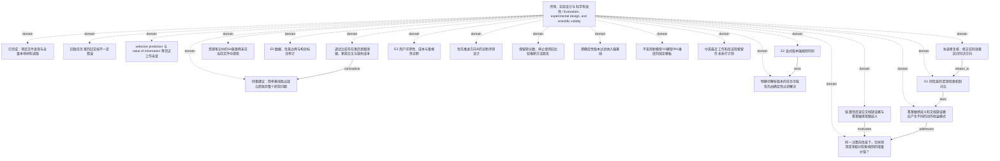

<!-- Generated by Agent Research Atlas; edit atlas.json via upsert or notes.md. -->
# 评测、实验设计与科学有效性 / Evaluation, experimental design, and scientific validity

[Atlas overview](../../MAP.md) · [Human notes](notes.md)

Coverage: **partial**

## Recorded relationships



## Evidence and exploration

### 已完成：项目文件发现与全量本地材料读取

`explore-local-inputs-20261021` · exploration · completed_local_only

```json
{
  "artifact_path": "design/evidence-synthesis.md",
  "language": "mixed",
  "limitations": "无网络、无真实论文核验；逐行64例、文档、标签不在本次可见输入中；非全域综述",
  "provider": "local_filesystem",
  "query": "atlas discover --root PROJECT; rg --files PROJECT; read all seven supplied content files and INPUT-MANIFEST.json",
  "result_ids": [
    "fixture-review-a",
    "fixture-study-b"
  ],
  "scope": "指定 discovery 项目；初始8文件，1个非原生地图；discover未截断",
  "searched_at": "2026-10-21",
  "synthetic_context": true
}
```

- worklog/inputs-before.json — access: local; locator: files array; physical input inventory and hashes
- research-map.md — access: local; locator: Five original bullets L3–7; full file

### 低置信度混合文档缺证据与答案敏感意图歧义

`problem-uncertainty-source` · problem · open

```json
{
  "artifact_path": "RESEARCH-DESIGN.md",
  "problem": "低置信度不足以识别应该从用户还是文档取得信息",
  "synthetic_context": true
}
```

- research-map.md — access: local; locator: L4
- papers/local-review.md — access: local; locator: Sections 1–3 (L4–6); full supplied fictional note

### 旧版任务里的旧文档不一定错误

`claim-old-document-valid` · claim · draft

```json
{
  "exact_note": "旧版任务里的旧文档不一定错误。保留这条提醒。",
  "interpretation": "正确性依任务目标版本和适用范围，不等同于新旧排序",
  "limitations": "合成情景的条件性设计原则",
  "status_reason": "保留人工提醒并作为评分约束；不是由真实研究验证的性能结论",
  "synthetic_context": true
}
```

- research-map.md — access: local; locator: L6
- papers/local-counterexample.md — access: local; locator: Sections 1–3 (L4–6); full supplied fictional note

### selective prediction 与 value of information 等邻近工作未查

`problem-neighboring-prior-art` · problem · unsearched

```json
{
  "artifact_path": "design/bilingual-retrieval-plan.md",
  "search_state": "all_remote_not_run_by_user_constraint",
  "synthetic_context": true,
  "unknowns": [
    "真实最近论文",
    "既有 benchmark 是否覆盖",
    "可复用许可与代码"
  ]
}
```

- research-map.md — access: local; locator: L7

### 调试比较存在事后意图泄漏、家族交叉与缺失成本

`problem-unfair-pilot` · problem · documented_fixture_issue

```json
{
  "artifact_path": "design/evidence-synthesis.md",
  "consequence": "不能据此确定方法优劣或放弃整个问题",
  "independence_issue": "8家族的64改写跨非正式训练/测试",
  "information_issue": "基线在路由前读取完整上下文后标注的reference_intent，候选没有",
  "observed_in_note": {
    "baseline_correct": 62,
    "families": 8,
    "router_correct": 51,
    "rows": 64
  },
  "reported_not_recomputed": true,
  "synthetic_context": true
}
```

- notes/comparison.md — access: local; locator: L3–8; full supplied fictional debug note

### 同事建议：简单基线胜出就立即放弃整个研究问题

`claim-abandon-from-debug` · claim · unsupported

```json
{
  "limitations": "未运行有效新比较",
  "reasoning": "调试分数不能识别方法效果；修复评测不代表候选其实获胜",
  "status_reason": "保留原建议以供审查；不公平输入与家族泄漏使该推断不成立，且没有可比较held-out",
  "synthetic_context": true
}
```

- notes/comparison.md — access: local; locator: L3–8; full supplied fictional debug note

### 资源笔记中的64条案例未在当前文件中提供

`problem-data-availability` · problem · blocked

```json
{
  "actual_inventory": "7 content files and one manifest; no case rows, document corpus, labels, family IDs or implementation",
  "artifact_path": "worklog/inputs-before.json",
  "next_check": "取得原始案例/文档/谱系和许可，不补造原数据",
  "reported_resource": "8 synthetic case families with 8 paraphrases",
  "synthetic_context": true
}
```

- notes/resources.md — access: local; locator: L3–5; full supplied resource note
- worklog/inputs-before.json — access: local; locator: files array; physical input inventory and hashes

### 同一决策前信息下，怎样测清澄清相对检索/规则的增量价值？

`problem-information-action-value` · problem · selected_for_design

```json
{
  "artifact_path": "design/benchmark-dossier.md",
  "depends_on": [
    "problem-uncertainty-source",
    "problem-explicit-version",
    "problem-unfair-pilot",
    "problem-data-availability"
  ],
  "non_goals": [
    "训练新模型",
    "声称新颖性",
    "生产用户收益外推"
  ],
  "primary_contribution": "measurement_and_evaluation",
  "problem_anchor": "RESEARCH-DESIGN.md",
  "synthetic_context": true
}
```

- papers/local-review.md — access: local; locator: Sections 1–3 (L4–6); full supplied fictional note
- papers/local-counterexample.md — access: local; locator: Sections 1–3 (L4–6); full supplied fictional note
- PROJECT.md — access: local; locator: L3–7; full supplied file

### 答案敏感歧义和文档缺证据应产生不同的动作收益模式

`hyp-information-source-value` · hypothesis · proposed

```json
{
  "artifact_path": "design/analysis-and-execution.md",
  "closest_paper_ids": [
    "fixture-review-a",
    "fixture-study-b"
  ],
  "closest_work_scope": "只覆盖本地虚构材料，真实最近工作未验证",
  "falsification": "有效协议下分层预测反向或由无关回复同幅解释；先排除标签、泄漏和实现错误",
  "feasibility": {
    "budget": "unverified",
    "compute": "unverified",
    "data": "unverified",
    "evaluation": "unverified"
  },
  "feasibility_notes": "本地设计可行；案例/文档未提供，双人标注/实现/未来运行预算未核实，本轮模型禁止",
  "mechanism": "仅从正确来源新增与答案相关的信息，才可能降低相应的不确定性；成本另计",
  "minimal_test": "合法同O0反事实对；有效/无关/无回复澄清与追加检索；族级配对",
  "prediction": "完整证据且缺用户目标的切片中有效澄清优于纯追加检索；目标确定且证据可检索的切片中检索有更直接收益",
  "problem": "同一低置信度可能对应不同的信息来源",
  "rival_explanations": [
    "额外推理/上下文",
    "循环构念与评分偏好",
    "隐藏意图泄漏",
    "家族/模板记忆",
    "合法条件回答已足够"
  ],
  "status_reason": "提出可反驳方案但真实最近工作、数据与执行条件不足，不升级testable或实证状态",
  "synthetic_context": true
}
```

- papers/local-review.md — access: local; locator: Sections 1–3 (L4–6); full supplied fictional note
- papers/local-counterexample.md — access: local; locator: Sections 1–3 (L4–6); full supplied fictional note

### 明确可解析版本的任务可能优先由确定性过滤解决

`hyp-explicit-version-rule` · hypothesis · proposed

```json
{
  "artifact_path": "design/analysis-and-execution.md",
  "closest_paper_ids": [
    "fixture-study-b"
  ],
  "falsification": "强规则仍稳定失败且正确可见版本输入足够；排查解析与生成责任",
  "feasibility": {
    "budget": "unverified",
    "compute": "unverified",
    "data": "unverified",
    "evaluation": "unverified"
  },
  "feasibility_notes": "本地设计可行；案例/文档未提供，双人标注/实现/未来运行预算未核实，本轮模型禁止",
  "mechanism": "从公开目标解析版本并过滤适用证据",
  "minimal_test": "明确旧/新版、无法解析参考日期分开，规则/无过滤/候选同信息比较",
  "prediction": "规则减少明确版本错误；学习门控未必有剩余价值",
  "problem": "明确旧版任务不应盲用最新文档",
  "rival_explanations": [
    "时间锚点/地域缺失",
    "解析规则过弱",
    "生成端未使用已正确过滤证据"
  ],
  "status_reason": "提出可反驳方案但真实最近工作、数据与执行条件不足，不升级testable或实证状态",
  "synthetic_context": true
}
```

- papers/local-counterexample.md — access: local; locator: Sections 1–3 (L4–6); full supplied fictional note
- research-map.md — access: local; locator: Five original bullets L3–7; full file

### E0 数据、信息边界与构念标注审计

`experiment-e0-construct` · experiment · planned_not_run

```json
{
  "artifact_kind": "design_only_not_run_record",
  "artifact_path": "design/annotation-and-data-contract.md",
  "blocking_condition": "数据/标注/实现未取得；模型运行不在本轮授权内",
  "depends_on": [
    "problem-data-availability",
    "problem-information-action-value"
  ],
  "execution_ready": false,
  "no_observed_result": true,
  "synthetic_context": true
}
```

- design/annotation-and-data-contract.md — access: local; locator: 对应设计节；全部为planned

### E1 同信息的澄清/检索机制对比

`experiment-e1-information` · experiment · planned_not_run

```json
{
  "amendment": "明确区间相对正向δ的方向；未达到δ只反对实际效果目标，不等于反驳机制；未执行实验",
  "analysis_protocol_revision": "design-v1.1",
  "artifact_kind": "design_only_not_run_record",
  "artifact_path": "design/analysis-and-execution.md",
  "blocking_condition": "数据/标注/实现未取得；模型运行不在本轮授权内",
  "depends_on": [
    "hyp-information-source-value",
    "experiment-e0-construct"
  ],
  "execution_ready": false,
  "no_observed_result": true,
  "review_artifact": "worklog/coordinator-protocol-review.md",
  "synthetic_context": true
}
```

- design/analysis-and-execution.md — access: local; locator: 对应设计节；全部为planned

### E2 显式版本强规则判别

`experiment-e2-version` · experiment · planned_not_run

```json
{
  "artifact_kind": "design_only_not_run_record",
  "artifact_path": "design/analysis-and-execution.md",
  "blocking_condition": "数据/标注/实现未取得；模型运行不在本轮授权内",
  "depends_on": [
    "hyp-explicit-version-rule",
    "experiment-e0-construct"
  ],
  "execution_ready": false,
  "no_observed_result": true,
  "synthetic_context": true
}
```

- design/analysis-and-execution.md — access: local; locator: 对应设计节；全部为planned

### E3 用户可得性、成本与鲁棒性诊断

`experiment-e3-cost` · experiment · planned_not_run

```json
{
  "artifact_kind": "design_only_not_run_record",
  "artifact_path": "design/analysis-and-execution.md",
  "blocking_condition": "数据/标注/实现未取得；模型运行不在本轮授权内",
  "depends_on": [
    "experiment-e1-information",
    "experiment-e2-version"
  ],
  "execution_ready": false,
  "no_observed_result": true,
  "synthetic_context": true
}
```

- design/analysis-and-execution.md — access: local; locator: 对应设计节；全部为planned

### 优先推进方向B的诊断评测设计

`decision-prioritize-evaluation` · decision · proceed_design

```json
{
  "artifact_path": "RESEARCH-DESIGN.md",
  "depends_on": [
    "problem-information-action-value",
    "hyp-information-source-value"
  ],
  "reason": "当前可改变投资决策的瓶颈是测量与公平性；不需要先提出新模型",
  "synthetic_context": true
}
```

- RESEARCH-DESIGN.md — access: local; locator: 对应决策与计划正文

### 保留原分数，停止使用旧比较推断方法胜负

`decision-repair-comparison` · decision · revise

```json
{
  "artifact_path": "design/evidence-synthesis.md",
  "depends_on": [
    "problem-unfair-pilot",
    "claim-abandon-from-debug"
  ],
  "reason": "修复同信息输入和家族切分；oracle只作诊断上界",
  "synthetic_context": true
}
```

- design/evidence-synthesis.md — access: local; locator: 对应决策与计划正文

### 把确定性版本过滤纳入强基线

`decision-strong-version-rule` · decision · proceed_design

```json
{
  "artifact_path": "design/benchmark-dossier.md",
  "depends_on": [
    "hyp-explicit-version-rule",
    "fixture-study-b"
  ],
  "reason": "明确版本与真正未指定版本是不同问题",
  "synthetic_context": true
}
```

- design/benchmark-dossier.md — access: local; locator: 对应决策与计划正文

### 不采用新模型/15模型/9%难度的固定模板

`decision-reject-fixed-template` · decision · reject_template

```json
{
  "artifact_path": "RESEARCH-DESIGN.md",
  "depends_on": [
    "problem-information-action-value"
  ],
  "reason": "这些固定阈值无本项目构念与资源依据；不等同发表规则",
  "synthetic_context": true
}
```

- RESEARCH-DESIGN.md — access: local; locator: 对应决策与计划正文

### 中英最近工作和反证检索留作未执行计划

`decision-bilingual-next` · decision · planned_not_run

```json
{
  "artifact_path": "design/bilingual-retrieval-plan.md",
  "depends_on": [
    "problem-neighboring-prior-art"
  ],
  "reason": "本轮禁止联网；真实查新 unresolved",
  "synthetic_context": true
}
```

- design/bilingual-retrieval-plan.md — access: local; locator: 对应决策与计划正文

### 协调者复核：修正实际效果区间判决方向

`decision-interval-review` · decision · amended_design

```json
{
  "artifact_path": "worklog/coordinator-protocol-review.md",
  "depends_on": [
    "experiment-e1-information"
  ],
  "reason": "原设计把区间排除δ一概当负判决，现拆分高于δ、低于δ、完全负与跨δ；无结果升级",
  "synthetic_context": true
}
```

- worklog/coordinator-protocol-review.md — access: local; locator: 发现、已采取的修订、影响审查

