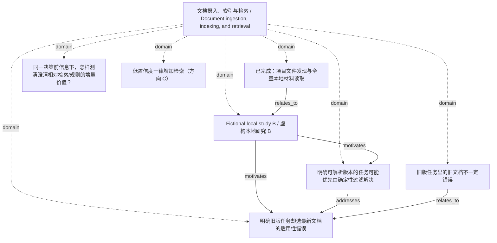

<!-- Generated by Agent Research Atlas; edit atlas.json via upsert or notes.md. -->
# 文档摄入、索引与检索 / Document ingestion, indexing, and retrieval

[Atlas overview](../../MAP.md) · [Human notes](notes.md)

Coverage: **partial**

## Recorded relationships



## Evidence and exploration

### Fictional local study B / 虚构本地研究 B

`fixture-study-b` · paper · synthetic_fixture

```json
{
  "claims": [
    "明确旧版本可用确定性过滤",
    "真正未指定且答案敏感的版本可通过澄清改变答案",
    "生产频率与用户容忍度未测"
  ],
  "limitations": "非真实发表研究；不证明所有歧义都值得问",
  "publication_status": "fictional_not_published",
  "read_depth": "full_supplied_note",
  "synthetic_context": true
}
```

- papers/local-counterexample.md — access: local; locator: Sections 1–3 (L4–6); full supplied fictional note

### 已完成：项目文件发现与全量本地材料读取

`explore-local-inputs-20261021` · exploration · completed_local_only

```json
{
  "artifact_path": "design/evidence-synthesis.md",
  "language": "mixed",
  "limitations": "无网络、无真实论文核验；逐行64例、文档、标签不在本次可见输入中；非全域综述",
  "provider": "local_filesystem",
  "query": "atlas discover --root PROJECT; rg --files PROJECT; read all seven supplied content files and INPUT-MANIFEST.json",
  "result_ids": [
    "fixture-review-a",
    "fixture-study-b"
  ],
  "scope": "指定 discovery 项目；初始8文件，1个非原生地图；discover未截断",
  "searched_at": "2026-10-21",
  "synthetic_context": true
}
```

- worklog/inputs-before.json — access: local; locator: files array; physical input inventory and hashes
- research-map.md — access: local; locator: Five original bullets L3–7; full file

### 明确旧版任务却选最新文档的适用性错误

`problem-explicit-version` · problem · documented_fixture_candidate

```json
{
  "boundary": "参考日期、版本与范围能明确解析时优先检查确定性过滤；无法解析另列",
  "next_check": "取得实际版本/文档对并按目标版本标注",
  "problem": "目标版本与文档适用版本不匹配",
  "synthetic_context": true
}
```

- research-map.md — access: local; locator: L3
- papers/local-counterexample.md — access: local; locator: Sections 1–3 (L4–6); full supplied fictional note

### 旧版任务里的旧文档不一定错误

`claim-old-document-valid` · claim · draft

```json
{
  "exact_note": "旧版任务里的旧文档不一定错误。保留这条提醒。",
  "interpretation": "正确性依任务目标版本和适用范围，不等同于新旧排序",
  "limitations": "合成情景的条件性设计原则",
  "status_reason": "保留人工提醒并作为评分约束；不是由真实研究验证的性能结论",
  "synthetic_context": true
}
```

- research-map.md — access: local; locator: L6
- papers/local-counterexample.md — access: local; locator: Sections 1–3 (L4–6); full supplied fictional note

### 同一决策前信息下，怎样测清澄清相对检索/规则的增量价值？

`problem-information-action-value` · problem · selected_for_design

```json
{
  "artifact_path": "design/benchmark-dossier.md",
  "depends_on": [
    "problem-uncertainty-source",
    "problem-explicit-version",
    "problem-unfair-pilot",
    "problem-data-availability"
  ],
  "non_goals": [
    "训练新模型",
    "声称新颖性",
    "生产用户收益外推"
  ],
  "primary_contribution": "measurement_and_evaluation",
  "problem_anchor": "RESEARCH-DESIGN.md",
  "synthetic_context": true
}
```

- papers/local-review.md — access: local; locator: Sections 1–3 (L4–6); full supplied fictional note
- papers/local-counterexample.md — access: local; locator: Sections 1–3 (L4–6); full supplied fictional note
- PROJECT.md — access: local; locator: L3–7; full supplied file

### 明确可解析版本的任务可能优先由确定性过滤解决

`hyp-explicit-version-rule` · hypothesis · proposed

```json
{
  "artifact_path": "design/analysis-and-execution.md",
  "closest_paper_ids": [
    "fixture-study-b"
  ],
  "falsification": "强规则仍稳定失败且正确可见版本输入足够；排查解析与生成责任",
  "feasibility": {
    "budget": "unverified",
    "compute": "unverified",
    "data": "unverified",
    "evaluation": "unverified"
  },
  "feasibility_notes": "本地设计可行；案例/文档未提供，双人标注/实现/未来运行预算未核实，本轮模型禁止",
  "mechanism": "从公开目标解析版本并过滤适用证据",
  "minimal_test": "明确旧/新版、无法解析参考日期分开，规则/无过滤/候选同信息比较",
  "prediction": "规则减少明确版本错误；学习门控未必有剩余价值",
  "problem": "明确旧版任务不应盲用最新文档",
  "rival_explanations": [
    "时间锚点/地域缺失",
    "解析规则过弱",
    "生成端未使用已正确过滤证据"
  ],
  "status_reason": "提出可反驳方案但真实最近工作、数据与执行条件不足，不升级testable或实证状态",
  "synthetic_context": true
}
```

- papers/local-counterexample.md — access: local; locator: Sections 1–3 (L4–6); full supplied fictional note
- research-map.md — access: local; locator: Five original bullets L3–7; full file

### 低置信度一律增加检索（方向 C）

`hyp-retrieve-all-lowconfidence` · hypothesis · parked

```json
{
  "artifact_path": "design/benchmark-dossier.md",
  "reopening_condition": "明确文档证据可取得且追加检索在成本边界内有益",
  "status_reason": "跨所有不确定来源的主线暂缓；保留B2为强基线和缺证据切片方案",
  "synthetic_context": true
}
```

- notes/research-options.md — access: local; locator: L3–7; full supplied note
- papers/local-review.md — access: local; locator: Sections 1–3 (L4–6); full supplied fictional note

