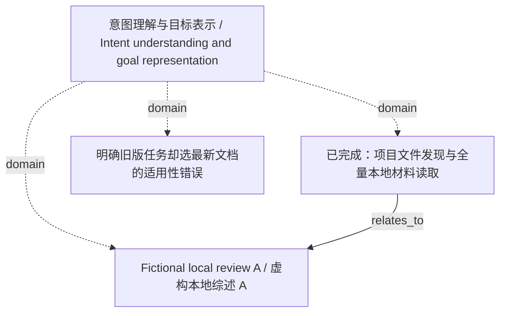

<!-- Generated by Agent Research Atlas; edit atlas.json via upsert or notes.md. -->
# 意图理解与目标表示 / Intent understanding and goal representation

[Atlas overview](../../MAP.md) · [Human notes](notes.md)

Coverage: **partial**

## Recorded relationships



## Evidence and exploration

### Fictional local review A / 虚构本地综述 A

`fixture-review-a` · paper · synthetic_fixture

```json
{
  "claims": [
    "固定意图例子未描述约束修正",
    "在供应例子中补检索可补证据，无法揭示未表明偏好",
    "比较取决于决策前可用信息"
  ],
  "limitations": "非真实发表研究；无实验原数据或检索边界",
  "publication_status": "fictional_not_published",
  "read_depth": "full_supplied_note",
  "synthetic_context": true
}
```

- papers/local-review.md — access: local; locator: Sections 1–3 (L4–6); full supplied fictional note

### 已完成：项目文件发现与全量本地材料读取

`explore-local-inputs-20261021` · exploration · completed_local_only

```json
{
  "artifact_path": "design/evidence-synthesis.md",
  "language": "mixed",
  "limitations": "无网络、无真实论文核验；逐行64例、文档、标签不在本次可见输入中；非全域综述",
  "provider": "local_filesystem",
  "query": "atlas discover --root PROJECT; rg --files PROJECT; read all seven supplied content files and INPUT-MANIFEST.json",
  "result_ids": [
    "fixture-review-a",
    "fixture-study-b"
  ],
  "scope": "指定 discovery 项目；初始8文件，1个非原生地图；discover未截断",
  "searched_at": "2026-10-21",
  "synthetic_context": true
}
```

- worklog/inputs-before.json — access: local; locator: files array; physical input inventory and hashes
- research-map.md — access: local; locator: Five original bullets L3–7; full file

### 明确旧版任务却选最新文档的适用性错误

`problem-explicit-version` · problem · documented_fixture_candidate

```json
{
  "boundary": "参考日期、版本与范围能明确解析时优先检查确定性过滤；无法解析另列",
  "next_check": "取得实际版本/文档对并按目标版本标注",
  "problem": "目标版本与文档适用版本不匹配",
  "synthetic_context": true
}
```

- research-map.md — access: local; locator: L3
- papers/local-counterexample.md — access: local; locator: Sections 1–3 (L4–6); full supplied fictional note

