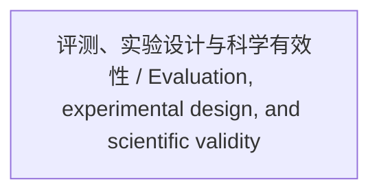

<!-- Generated by Agent Research Atlas; edit atlas.json via upsert or notes.md. -->
# 评测、实验设计与科学有效性 / Evaluation, experimental design, and scientific validity

[Atlas overview](../../MAP.md) · [Human notes](notes.md)

Coverage: **unsearched**

## Recorded relationships

## Evidence and exploration

