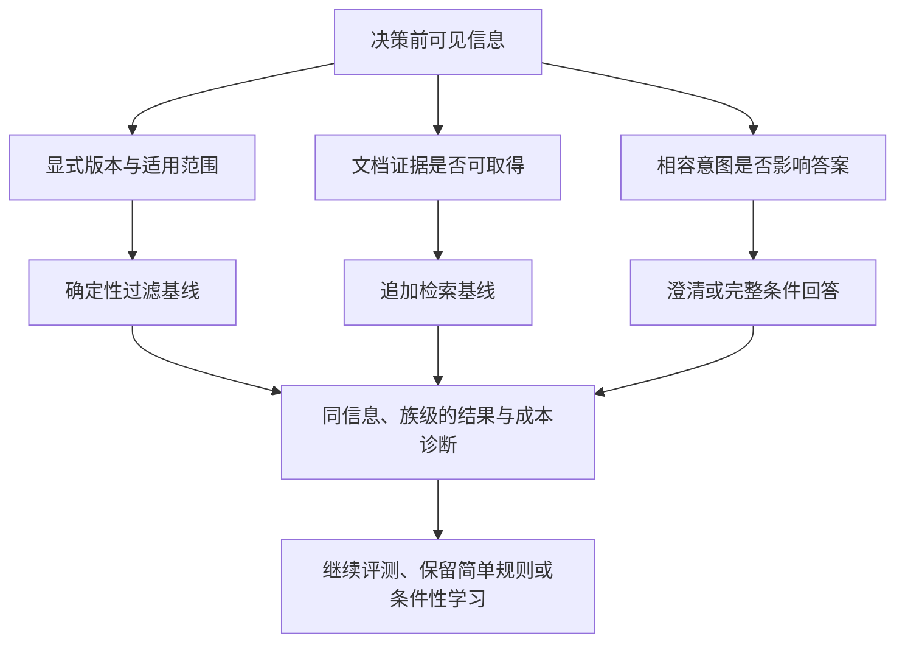

# 意图/文档 Agent 研究地图：修订视图

2026-10-21 · Atlas revision 5 · **合成情景设计，非实证结论**。

原始 `research-map.md` 保持原文和哈希。本视图延续其内容；权威结构化记录为 [atlas.json](research-atlas/atlas.json)，自动总览为 [MAP.md](research-atlas/MAP.md)，离线交互图为 [map.html](research-atlas/map.html)。

## 现在的研究主线

**同一决策前信息下，澄清何时比补检索、版本过滤或条件回答更有价值？** 优先建设诊断评测协议，先排除信息泄漏和家族污染，再决定是否值得学习一个路由器。[研究设计](RESEARCH-DESIGN.md)

图中箭头表示计划中的依赖与比较，不是已观测的因果效应。A/E/V 允许交叉；混合缺口单列。完整定义和负对照见 [评测方案](design/benchmark-dossier.md)。

## 旧地图五条内容的保留与归一化

| 原位置与含义 | 稳定节点 | 当前处理 |
|---|---|---|
| L3：按去年规则却拿最新规则 | `problem-explicit-version` | 先核对时间锚点/适用范围，纳入强规则基线 |
| L4：低置信度有不同来源 | `problem-uncertainty-source` | 作为主问题；分开缺证据和答案敏感歧义 |
| L5：所有低置信度都追问已暂停 | `hyp-ask-all-lowconfidence` | 继续 parked；新价值与成本证据才重开 |
| L6：旧文档提醒 | `claim-old-document-valid` | 原句保留：“旧版任务里的旧文档不一定错误。” |
| L7：selective prediction / value of information 未查 | `problem-neighboring-prior-art` | 保持 unsearched；已写双语计划，未执行查询 |

导入已完成语义归一化，不再只是登记；原输入没有被覆盖。其他种子领域仍 unsearched，本轮重点领域只有本地材料的 partial 覆盖。

## 领域入口

| 领域 | 当前结论与问题 | 人工笔记 |
|---|---|---|
| 意图 | 相容意图、答案敏感性、约束是否已明确；多轮改口后续再开 | [intent](research-atlas/domains/intent/notes.md) |
| 澄清 | 分开有效信息上界、真实回复概率、条件回答和成本 | [clarification](research-atlas/domains/clarification/notes.md) |
| 路由 | A 训练暂缓，C 保留基线；旧调试数字没有方法胜负效力 | [routing](research-atlas/domains/routing/notes.md) |
| 文档检索 | 旧版任务可用旧文档；补检索只在信息可取得时有机会 | [ingestion-retrieval](research-atlas/domains/ingestion-retrieval/notes.md) |
| 评测 | 同信息、防标签泄漏、族级划分、集合答案、诊断与成本 | [evaluation](research-atlas/domains/evaluation/notes.md) |

## 当前状态与下一步

选择 B 是投入设计的决策，不是已验证的科学结论。H1/H2 都为 proposed；学习门控、一律追问和全域一律检索主线保留 parked。没有 pilot_supported、independently_supported 或 refuted 实证状态。旧分数保留，支持“立即整体弃题”的推断记 unsupported。

第一步取得资源笔记中的真实逐行案例/文档/家族 ID，再做信息边界和构念标注；当前只有说明文件。随后才建立实际 split、实现评价器与基线，并在资源落实后冻结探索性或新的确认性计划。[分析与执行](design/analysis-and-execution.md) · [中英检索计划](design/bilingual-retrieval-plan.md) · [交接](HANDOFF.md)

## 协调者协议复核后的修订

分析协议已按独立上下文的逻辑复核更新至 design-v1.1，明确效应区间相对正向 δ 的方向。修订和受影响节点审查见 [复核记录](worklog/coordinator-protocol-review.md)。没有新结果或假设升级；相关三个 pending reviews 已逐项审查并留痕。
