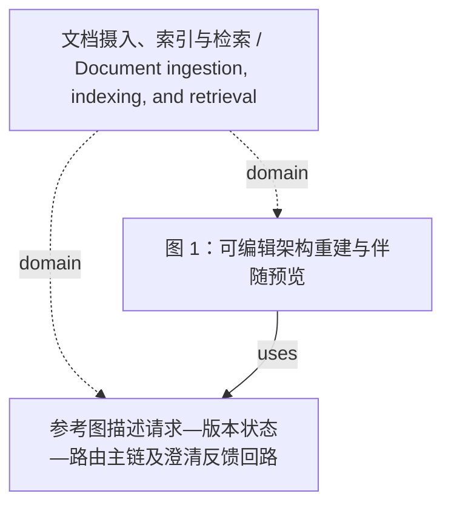

<!-- Generated by Agent Research Atlas; edit atlas.json via upsert or notes.md. -->
# 文档摄入、索引与检索 / Document ingestion, indexing, and retrieval

[Atlas overview](../../MAP.md) · [Human notes](notes.md)

Coverage: **unsearched**

## Recorded relationships



## Evidence and exploration

### 参考图描述请求—版本状态—路由主链及澄清反馈回路

`claim-reference-topology` · claim · draft

```json
{
  "claim_type": "descriptive_diagram",
  "limitations": [
    "Describes supplied architecture topology only; does not establish method effectiveness."
  ],
  "statement": "User request → Version state → Router; Router → Retriever → Answer; Router → Clarify → User request.",
  "status_reason": "Bounded descriptive figure text; no empirical support state assigned."
}
```

- reference.png — access: local; locator: whole 1000 x 540 image; visually inspected six modules and six directed connectors
- PROJECT.md — access: local; locator: line 5: reference topology

### 图 1：可编辑架构重建与伴随预览

`figure-architecture` · decision · produced_native_render_pending

```json
{
  "artifact_path": "outputs/fig01_architecture.drawio",
  "code_path": "scripts/rebuild_architecture.py",
  "depends_on": [
    "claim-reference-topology"
  ],
  "editable_source": "sources/architecture_scene.json",
  "figure_id": "fig01_architecture",
  "layout_change": "Feedback label moved below Clarify to avoid overlap; topology unchanged.",
  "native_drawio_render": "not performed: no installed renderer",
  "native_elements": {
    "connectors": 6,
    "extra_labels": 2,
    "modules": 6,
    "raster_regions": 1
  },
  "previews": [
    "outputs/fig01_architecture.png",
    "outputs/fig01_architecture.pdf",
    "checks/fig01_architecture_pdf_render.png"
  ],
  "raster_source": "reference.png crop [825,345,926,446)",
  "status_reason": "Native source structurally checked and SVG/PDF previews inspected; draw.io application render and interactive endpoint behavior remain unverified."
}
```

- outputs/fig01_architecture.drawio — access: local; locator: mxGraphModel/root: six module vertices and six directed edges
- outputs/fig01_architecture.svg — access: local; locator: modules/connectors/labels/source_detail_image
- VALIDATION.md — access: local; locator: 架构图
- EDITING.md — access: local; locator: drawio 对象与连线

