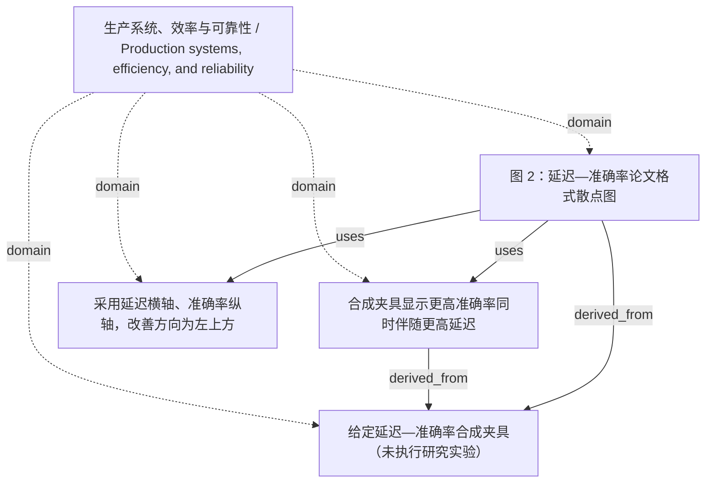

<!-- Generated by Agent Research Atlas; edit atlas.json via upsert or notes.md. -->
# 生产系统、效率与可靠性 / Production systems, efficiency, and reliability

[Atlas overview](../../MAP.md) · [Human notes](notes.md)

Coverage: **unsearched**

## Recorded relationships



## Evidence and exploration

### 给定延迟—准确率合成夹具（未执行研究实验）

`fixture-latency-accuracy` · experiment · supplied_synthetic_fixture_not_run

```json
{
  "actual_execution": "none; only local chart generation occurred",
  "artifact_path": "results/latency-accuracy.csv",
  "limitations": [
    "All input values are synthetic fixtures.",
    "No repeated runs, sample denominator, task setting, hardware, or uncertainty estimates were supplied.",
    "No literature search or novelty assessment was authorized or performed."
  ],
  "record_type": "supplied_fixture_only",
  "status_reason": "Source values are explicitly synthetic; recording their provenance without marking any method scientifically supported.",
  "synthetic": true
}
```

- results/latency-accuracy.csv — access: local; locator: header and rows 2–4
- PROJECT.md — access: local; locator: line 3: synthetic and resource constraints
- notes/figure-context.md — access: local; locator: line 3: synthetic data and missing uncertainty

### 合成夹具显示更高准确率同时伴随更高延迟

`claim-fixture-tradeoff` · claim · draft

```json
{
  "claim_type": "descriptive_fixture_only",
  "depends_on": [
    "fixture-latency-accuracy"
  ],
  "limitations": [
    "All input values are synthetic fixtures.",
    "No repeated runs, sample denominator, task setting, hardware, or uncertainty estimates were supplied.",
    "No literature search or novelty assessment was authorized or performed."
  ],
  "statement": "Single-pass: 120 ms, 68.75%; Version-aware: 180 ms, 78.125%; Always-clarify: 310 ms, 81.25%. The values form a latency–accuracy trade-off; no statistical conclusion is drawn.",
  "status_reason": "Retain draft scientific wording because supplied fixture values are not real experimental evidence."
}
```

- results/latency-accuracy.csv — access: local; locator: rows 2–4
- outputs/fig02_data_ledger.json — access: local; locator: /rows and /derived_differences
- CAPTIONS.md — access: local; locator: 图 2 / Figure 2

### 采用延迟横轴、准确率纵轴，改善方向为左上方

`decision-axis-semantics` · decision · adopted

```json
{
  "axes": {
    "x": "latency_ms; lower is better",
    "x_range": [
      0,
      350
    ],
    "y": "accuracy*100; higher is better",
    "y_range": [
      65,
      86
    ]
  },
  "reason": "Latency is minimized and accuracy maximized. Upper right means higher latency as well as higher accuracy, so the informal team note does not govern the plot.",
  "status_reason": "Preserve the supplied quantities and their optimization directions."
}
```

- notes/figure-context.md — access: local; locator: line 3: quantity direction and conflicting team note
- notes/FIGURE-BRIEF.md — access: local; locator: 图 2: 编码与量纲

### 图 2：延迟—准确率论文格式散点图

`figure-latency-accuracy` · decision · produced_and_previewed

```json
{
  "artifact_path": "outputs/fig02_latency_accuracy.svg",
  "code_path": "scripts/plot_latency_accuracy.py",
  "depends_on": [
    "claim-fixture-tradeoff",
    "fixture-latency-accuracy",
    "decision-axis-semantics"
  ],
  "figure_id": "fig02_latency_accuracy",
  "limitations": [
    "All input values are synthetic fixtures.",
    "No repeated runs, sample denominator, task setting, hardware, or uncertainty estimates were supplied.",
    "No literature search or novelty assessment was authorized or performed."
  ],
  "previews": [
    "outputs/fig02_latency_accuracy.png",
    "outputs/fig02_latency_accuracy.pdf",
    "checks/fig02_svg_render.png",
    "checks/fig02_latency_accuracy_pdf_render.png"
  ],
  "status_reason": "CSV values checked and actual Matplotlib/ SVG/PDF previews inspected after repairing the x-axis/footer overlap. Artifact readiness is not empirical validation."
}
```

- outputs/fig02_latency_accuracy.svg — access: local; locator: vector chart with editable text
- outputs/fig02_data_ledger.json — access: local; locator: /rows, /axes and /derived_differences
- VALIDATION.md — access: local; locator: 数据图
- scripts/plot_latency_accuracy.py — access: local; locator: main: direct CSV plotting and layout checks

