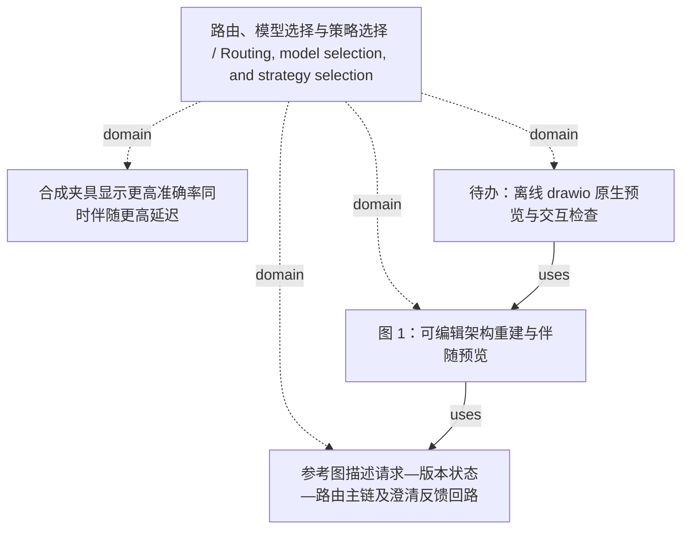

<!-- Generated by Agent Research Atlas; edit atlas.json via upsert or notes.md. -->
# 路由、模型选择与策略选择 / Routing, model selection, and strategy selection

[Atlas overview](../../MAP.md) · [Human notes](notes.md)

Coverage: **unsearched**

## Recorded relationships



## Evidence and exploration

### 参考图描述请求—版本状态—路由主链及澄清反馈回路

`claim-reference-topology` · claim · draft

```json
{
  "claim_type": "descriptive_diagram",
  "limitations": [
    "Describes supplied architecture topology only; does not establish method effectiveness."
  ],
  "statement": "User request → Version state → Router; Router → Retriever → Answer; Router → Clarify → User request.",
  "status_reason": "Bounded descriptive figure text; no empirical support state assigned."
}
```

- reference.png — access: local; locator: whole 1000 x 540 image; visually inspected six modules and six directed connectors
- PROJECT.md — access: local; locator: line 5: reference topology

### 合成夹具显示更高准确率同时伴随更高延迟

`claim-fixture-tradeoff` · claim · draft

```json
{
  "claim_type": "descriptive_fixture_only",
  "depends_on": [
    "fixture-latency-accuracy"
  ],
  "limitations": [
    "All input values are synthetic fixtures.",
    "No repeated runs, sample denominator, task setting, hardware, or uncertainty estimates were supplied.",
    "No literature search or novelty assessment was authorized or performed."
  ],
  "statement": "Single-pass: 120 ms, 68.75%; Version-aware: 180 ms, 78.125%; Always-clarify: 310 ms, 81.25%. The values form a latency–accuracy trade-off; no statistical conclusion is drawn.",
  "status_reason": "Retain draft scientific wording because supplied fixture values are not real experimental evidence."
}
```

- results/latency-accuracy.csv — access: local; locator: rows 2–4
- outputs/fig02_data_ledger.json — access: local; locator: /rows and /derived_differences
- CAPTIONS.md — access: local; locator: 图 2 / Figure 2

### 图 1：可编辑架构重建与伴随预览

`figure-architecture` · decision · produced_native_render_pending

```json
{
  "artifact_path": "outputs/fig01_architecture.drawio",
  "code_path": "scripts/rebuild_architecture.py",
  "depends_on": [
    "claim-reference-topology"
  ],
  "editable_source": "sources/architecture_scene.json",
  "figure_id": "fig01_architecture",
  "layout_change": "Feedback label moved below Clarify to avoid overlap; topology unchanged.",
  "native_drawio_render": "not performed: no installed renderer",
  "native_elements": {
    "connectors": 6,
    "extra_labels": 2,
    "modules": 6,
    "raster_regions": 1
  },
  "previews": [
    "outputs/fig01_architecture.png",
    "outputs/fig01_architecture.pdf",
    "checks/fig01_architecture_pdf_render.png"
  ],
  "raster_source": "reference.png crop [825,345,926,446)",
  "status_reason": "Native source structurally checked and SVG/PDF previews inspected; draw.io application render and interactive endpoint behavior remain unverified."
}
```

- outputs/fig01_architecture.drawio — access: local; locator: mxGraphModel/root: six module vertices and six directed edges
- outputs/fig01_architecture.svg — access: local; locator: modules/connectors/labels/source_detail_image
- VALIDATION.md — access: local; locator: 架构图
- EDITING.md — access: local; locator: drawio 对象与连线

### 待办：离线 drawio 原生预览与交互检查

`decision-native-review-pending` · decision · open

```json
{
  "depends_on": [
    "figure-architecture"
  ],
  "next_action": "Open the delivered .drawio in an already available offline editor; verify all six directed edges, editable text, raster panel and endpoint attachment, then export and inspect a native preview.",
  "reason": "No native draw.io renderer was installed; no installation or network use is authorized.",
  "status_reason": "Do not substitute SVG rendering or XML validity for native draw.io validation."
}
```

- VALIDATION.md — access: local; locator: 保留余项 item 1
- EDITING.md — access: local; locator: drawio 对象与连线

